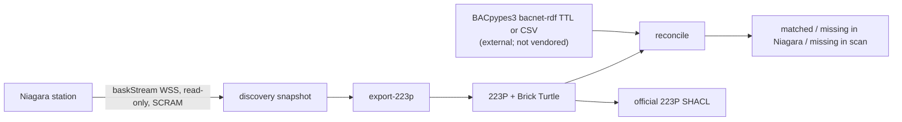

# Architecture

## Primary path

BACpypes3 scan *code* is not copied into this repository. The scan side is a document
(TTL or CSV) that already uses `bacnet://<device>/<type>,<instance>` identity, typically
written by a BACpypes3 BACnet-to-RDF run. The Niagara side is a read-only baskStream
session. `reconcile` compares the two by that URI.



Both sides go through one reference builder, so the reference node for a given
(device, object type, object instance) is identical whether it came from Niagara or
from a scan. Niagara display names stay labels; only BACnet-sourced names become
`bacnet:object-name`.

The client is read-only: write operations are refused locally, the SCRAM server
signature is verified, and credentials are never printed or written to outputs.

The emitted graph is an *external-reference* model: `s223:Equipment` (not a guessed
subclass), `s223:Property` subclasses with their superclass chain so official NodeShapes
apply without a reasoner, `s223:hasProperty`, QUDT unit and quantity kind, enumeration
kind, and `s223:BACnetExternalReference` / Brick `ref:BACnetReference`. It is not a
complete 223 topology (no connection points or sensors).

## Validating the TTL against official 223P

1. [OntoEnv](https://github.com/gtfierro/ontoenv-rs) manages ontology imports and versions.
   The pinned 223P file and the closure it needs (QUDT 3.4.0 `qudt-all`, SHACL, SKOS, VAEM)
   are vendored under `bask_223p/ontologies/223p/`. OntoEnv loads those files offline and
   `copy_closure` returns a mutable `rdflib.Graph`. Live fetches are not used: the VAEM
   URL can return HTML, which is not RDF.
2. `validate_223p` runs [Shifty](https://github.com/gtfierro/shifty) `0.6.0` on that closure
   with Shifty's defaults and `minimum_severity="Violation"`. OntoEnv is `0.6.4`, offline
   and strict. A missing engine is an error. `--cross-check pyshacl` does not set `conforms`.
3. `conforms` means no Violations. Warnings such as a missing `s223:Sensor` that `observes`
   a property are expected for this graph style.

## Secondary tools

```
FQPN / point inventory CSV  ----------------------->  lexical audit (suggestions only)
           |                                            |
           v                                            v
    local RDF topology  <------------------------- human approval
           |
           +----> reviewed BACnet addresses --> SPARQL / binding tables
           |
           +----> authored 223/Brick templates (optional, not bundled)
                             |
                             +----> ontology imports closure
                                           |
                             +-------------+---> SHACL validation
```

Approved class assignments are opt-in. A passing SHACL run is not proof of HVAC
engineering correctness or write safety.
