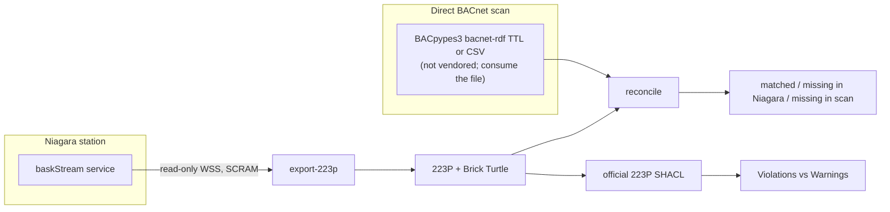

# open-hvac-edge

baskStream → ASHRAE 223P TTL maker, with a Microdot edge app under `examples/edge-microdot`.

Read a Niagara 4 station **read-only** over [baskStream](https://github.com/rbhans/bask-stream)
(authenticated WebSocket, MessagePack, API 1.12 and later) and write an **external ASHRAE 223P + Brick
Turtle graph**. Every BACnet-proxied point carries a 223P `BACnetExternalReference` (223P 2nd public
review draft, section 11.18.1). References use the same `bacnet://<device>/<type>,<instance>` URI
shape as a BACpypes3 BACnet-to-RDF site-scan document, so a TTL made from Niagara and a TTL made
from a direct bench scan share identity and can be **reconciled**.

The Niagara client writes nothing to a station. It refuses every non-read operation
locally, verifies the SCRAM server signature, and never prints or stores credentials.
The edge BACnet driver can write only when `EDGE_BACNET_WRITES_ENABLED` is set and the
caller is an `admin`; that flag ships off. It never maps or polls every point on a live
system: legacy MS/TP and IoT networks bottleneck easily. Modbus on the edge is read-only.

This is an *external-reference* graph (equipment, properties, BACnet bindings, QUDT units). It is
not a full 223 topology model: it does not invent ducts, connection points, or sensors.

## Architecture

BACpypes3 scan code is **not vendored** here. The scan side is a TTL (or CSV) produced by a
BACpypes3 BACnet-to-RDF run, or by any other tool that writes the same `bacnet://` URIs. Once that
output exists in a BACpypes3 release, this project can also depend on that package. The Niagara
side is baskStream. `reconcile` (alias `match`) joins the two by device instance + object
identifier (`bacnet://<device>/<type>,<instance>`).



## OT protocol libraries

BACpypes3, pymodbus (the optional Modbus extra), and the other packages named in
[`ot-protocols.txt`](ot-protocols.txt) stay on the latest stable release. The
pin is that file plus the same `==` version in the matching `pyproject.toml`.
Dependabot (`.github/dependabot.yml`) opens weekly updates for pip dependencies
and the Docker base images. `.github/workflows/ot-protocols.yml` runs every
Monday and on manual dispatch: it installs the latest releases of the OT
packages, runs the edge tests, and opens or updates a pull request when they
pass or an `ot-protocols` issue when they fail.

## Quick start (PowerShell, Python 3.11+)

```powershell
cd open-hvac-edge
py -3.11 -m venv .venv
.\.venv\Scripts\Activate.ps1
python -m pip install -e ".[all]"
python -m pytest -q
```

On macOS / Linux use `python3 -m venv .venv` and `source .venv/bin/activate`.

## 1. baskStream → 223P TTL (`export-223p`)

Offline, from the bundled credential-free discovery snapshot:

```powershell
python -m bask_223p export-223p --snapshot examples/baskstream-ahu-snapshot.json `
  --base https://example.org/lab `
  --manifest outputs/demo-223p/bindings.csv `
  --validate-out outputs/demo-223p/validate `
  --out outputs/demo-223p/site-223p.ttl
```

Live, against a station running the baskStream module (see
[docs/station-setup.md](docs/station-setup.md) and [docs/punch-list.md](docs/punch-list.md)):

```powershell
python -m bask_223p export-223p --station https://localhost --insecure `
  --env-file path/to/station.env `
  --base https://example.org/lab `
  --save-snapshot outputs/station/snapshot.json `
  --validate-out outputs/station/validate `
  --out outputs/station/site-223p.ttl
```

* `--env-file` holds `NIAGARA_USER` / `NIAGARA_PASS` (use a dedicated read-only station user).
  Values are never printed or written to any output.
* `--insecure` skips TLS verification for a localhost self-signed station certificate only.
* `--ws-auth-header` sends an `Authorization` header on the WebSocket handshake, for a service with
  `requireAuthorizationHeader = true`.
* `--limit` caps nodes per `search` (default 1000); truncated searches are reported as warnings.
* `--save-snapshot` writes the discovery snapshot so later runs can be repeated offline with `--snapshot`.
* `--mappings` applies **reviewed** `FQPN,ClassURI,Status` assignments. Brick / 223P *equipment*
  subclasses are never assigned from name similarity.
* `--shapes path/to/223p.ttl` runs official 223P SHACL (see below).

What lands in the TTL, per bound point:

```turtle
<base/point/...> a s223:QuantifiableObservableProperty, s223:QuantifiableProperty,
        s223:ObservableProperty, s223:Property, s223:Concept ;
    s223:hasExternalReference <base/bacnet-ref/…> ;
    qudt:hasUnit unit:DEG_F ;
    qudt:hasQuantityKind qk:Temperature .
<base/bacnet-ref/…> a s223:BACnetExternalReference, s223:ExternalReference ;
    bacnet:object-identifier "analog-value,1" ;
    bacnet:device-identifier "device,10001" ;
    bacnet:property-identifier "present-value" ;
    bacnet:objectOf <bacnet://10001> ;
    ref:BACnetURI "bacnet://10001/analog-value,1" .
```

The model also declares `owl:imports <http://data.ashrae.org/standard223/1.0/model/all>` so an
ontology environment can resolve 223P and its dependencies. Both Niagara (`--snapshot`/`--station`)
and BACpypes3 scan (`--input`) exports flow through one shared intermediate `BacnetPoint` model and
emitter, producing identical 223P TTL for the same `(device, type, instance)`. Niagara-only metadata
(slot path, display name, proxy extension type, facets) is written to a separate `.niagara.ttl`
annotation graph (`niagara:` namespace) outside the 223P shapes so SHACL ignores it and Niagara
display names never collide with `bacnet:object-name`. When `--input` is a BACpypes3 scan TTL, the
raw scan graph is preserved as a `.scan-sidecar.ttl` sidecar rather than mixed into the 223P graph.

Niagara points without a BACnet address (e.g. `NullProxyExt` folders) receive a deterministic
`niagara://` URI and `niagara:NiagaraExternalReference` (a concrete subclass of
`s223:ExternalReference`) flagged with `niagara:noBacnetSource true`, surfaced as a `NoBacnetSource`
warning rather than a broken reference. Quantifiable properties get a QUDT unit and QuantityKind
from the unit (never guessed from the point name); numeric points without a resolved unit/QuantityKind
omit `s223:QuantifiableProperty` so they do not fail 223P's `qudt:hasQuantityKind` SHACL constraint.
Niagara water-column spellings such as `in/wc`, `inH2O`, and `in. W.C.` map to official `unit:IN_H2O`
and `quantitykind:Pressure`. BACnet File `file-size` (octets per ASHRAE 135, often with no facet unit)
uses official `unit:BYTE` and `quantitykind:ByteDataVolume` rather than an invented term.
Boolean points use `s223:EnumerationKind-Binary`; other enumerations get a local `EnumerationKind`
labelled from the facet range.

## 2. Reconcile with a BACnet scan (`reconcile`, alias `match`)

```powershell
python -m bask_223p reconcile --niagara outputs/station/site-223p.ttl `
  --scan path/to/site-scan.ttl --out outputs/reconcile --merged-out outputs/reconcile/merged.ttl
```

* `--niagara`: an `export-223p` TTL or a discovery snapshot JSON.
* `--scan`: a BACpypes3 site-scan TTL (`bacnet/2020` or `bacnet/2024`), its CSV
  (`DeviceID,ObjType,ObjInst,Name,...,Units`), or any CSV/TTL `export-bacnet-refs` accepts.
  This repository does not ship the scanner.
* Output: `matched`, `missing_in_niagara`, `missing_in_scan`, plus name/unit flags, device-level
  counts, and skipped non-point object types (`--all-object-types` keeps them).
* `--merged-out` writes the union; shared objects collapse onto one reference node.
* `--strict` exits 1 when anything is missing on either side.

`examples/bench-scan.ttl` is a small synthetic scan in that RDF shape, for tests only.

## 3. Validate against official 223P SHACL

One command, one function: `validate_223p`. Pins are `ontoenv==0.6.4` and `pyshifty==0.6.0`
(`pip install "bask-223p[graph]"`). The 223P file is the vendored copy of
`https://open223.info/223p.ttl`, sha256
`08f80bd6e15052f28cdfd354bdf46ff96e5e1afdba36a4dbed5186fc1ea51c41`.

```powershell
python -m bask_223p validate --data outputs/site-223p.ttl --shapes path/to/223p.ttl --online --out outputs/validation
```

`--online` copies the vendored import closure (QUDT 3.4.0 `qudt-all`, SHACL, SKOS, VAEM)
into the output directory. It does not fetch. OntoEnv resolves that closure offline
(`copy_closure`, strict), then `shifty.validate` runs with its defaults and
`minimum_severity="Violation"`. A missing engine or a short closure is an error.
`--cross-check pyshacl` runs pySHACL 0.40.2 with `advanced=True` and does not set `conforms`.

`export-223p --shapes` and live-ingest `POST /api/model/validate` call the same function.
`conforms` is true when there are no SHACL Violations. Warnings are recorded and do not fail
the run. An external-reference graph commonly warns that an `ObservableProperty` is not pointed
at by a `s223:Sensor` (`s223:observes`). That is expected until a reviewer authors sensors and
connection points.

## 4. Inventory references, bindings and nHaystack check

```powershell
python -m bask_223p export-bacnet-refs --input examples/fec-test-bench-points.csv --base https://example.org/lab --out outputs/bacnet-refs.ttl --manifest outputs/point-bindings.csv
python -m bask_223p export-bindings --data outputs/bacnet-refs.ttl --out outputs/point-bindings.csv
python -m bask_223p check-haystack --expected outputs/point-bindings.csv --grid examples/fec-haystack-grid.json --out outputs/haystack-check
```

See [docs/niagara-import-plan.md](docs/niagara-import-plan.md).

## 5. Secondary: terminology coverage, site graphs and SHACL tools

These pre-date the baskStream path and are kept for review work. Same ontology environment and
SHACL engine as above, exposed as `closure`, `validate`, `infer`, `findings`, and friends.

```powershell
python -m bask_223p audit --requirements path/to/requirements.csv --catalog Brick=path/to/brick.ttl --out outputs/audit
python -m bask_223p build --csv examples/bacnet_points.csv --base https://example.org/demo --out outputs/site.ttl
python -m bask_223p validate --data outputs/site-223p.ttl --shapes path/to/223p.ttl --imports-dir path/to/closure
```

Exit codes: 0 ok, 1 non-conformance / strict mismatch, 2 bad input or setup error.

## 6. Examples: live telemetry ingest and SPARQL playground

* [`examples/live-ingest/`](examples/live-ingest/README.md) — unified read-only FastAPI service and CLI (`--source baskstream | bacnet | both`) that pairs a `pyoxigraph` SPARQL layer with a local **DuckDB** (`telemetry` keyed by `bacnet://` ref) and **CSV** time-series sink, a `/playground` SPARQL + DuckDB SQL UI, WebSocket `/live`, an Open-FDD DuckDB SQL fault prototype notebook, and `niagara` / `bacnet` Docker Compose profiles. 223P validation calls `validate_223p`.
* [`examples/sparql-playground/`](examples/sparql-playground/README.md) — self-contained Brick + SPARQL + SQLite tutorial API (`brickts`), lessons, `.rq` query library, sample building dataset, and Docker setup (archived from `bbartling/sparql-playground`).

## Package layout

| Package | Role |
|---|---|
| `bask_223p.bacnet.baskstream` | read-only baskStream client and discovery |
| `bask_223p.bacnet.export223` | snapshot → 223P + Brick TTL, built-in ref checks, official SHACL |
| `bask_223p.bacnet.refs` | shared `BacnetPoint` model, `bacnet://` / `niagara://` builders, CSV/scan loaders |
| `bask_223p.bacnet.units` | shared cached Niagara & BACnet unit -> QUDT / QuantityKind resolver |
| `bask_223p.bacnet.reconcile` | Niagara ↔ scan join and merged graph |
| `bask_223p.bacnet.haystack` | read-only nHaystack check |
| `bask_223p.audit`, `.model`, `.validate` | secondary coverage, site-graph and SHACL tools |

## Tests

```powershell
python -m pytest -q
# official 223P SHACL (slow): download 223p.ttl, then
$env:S223_SHAPES="path\to\223p.ttl"
python -m pytest -q tests/test_official_223p_shacl.py
```

The baskStream tests run against `tests/fake_baskstream_station.py`, a local stand-in for the
1.12 and 1.14 wire protocol. Set `BASK_DEMO_URL` to also run against `bask demo --serve`.
`tests/test_integration.py` uses the real Shifty and OntoEnv wheels and skips when they are
absent.

Outputs go to `outputs/` (gitignored). Keep site inventories and scan files out of git.

## Credits and license

[baskStream](https://github.com/rbhans/bask-stream) is an Apache-2.0 Niagara module by
BASidekick / [QA Graphics](https://www.qagraphics.com/). This project talks to it read-only
and is not affiliated with that project.

The external references follow ASHRAE 223P `BACnetExternalReference` (2nd public review draft,
section 11.18.1) and the `bacnet://<device>/<type>,<instance>` URI shape used by BACpypes3
BACnet-to-RDF output. Official 223P shapes: [open223.info/223p.ttl](https://open223.info/223p.ttl),
[ASHRAE Standard 223 supporting material](https://data.ashrae.org/standard223/standard223.html).

This repository is licensed under the MIT License. Copyright (c) 2026 Ben Bartling. See `LICENSE`.
