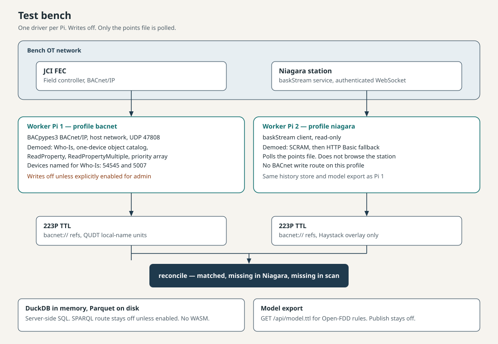
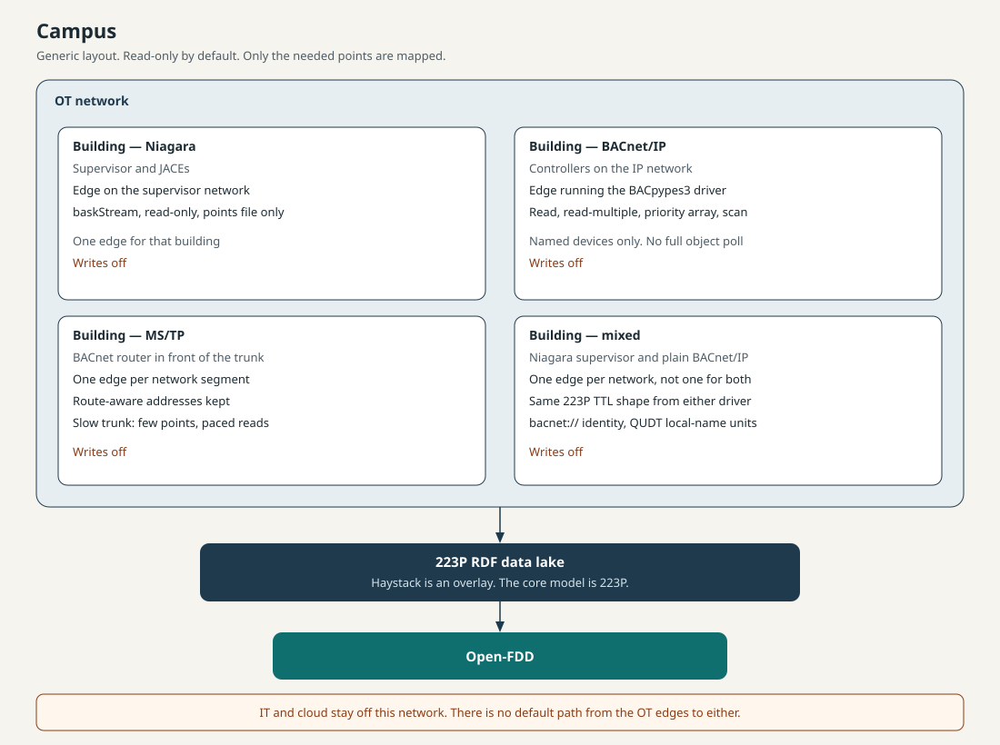

# open-hvac-edge

Edge software for HVAC networks. ASHRAE 223P is the model. Haystack tags are an overlay, used only where a binding needs them. Two drivers produce the same `bacnet://<device>/<type>,<instance>` identity and QUDT local-name units:

- **BACnet/IP** through BACpypes3 (read, read-multiple, priority array, scan). Writes are off unless `EDGE_BACNET_WRITES_ENABLED` is set and the caller is an admin.
- **Niagara** through [baskStream](https://github.com/rbhans/bask-stream), an authenticated WebSocket client that is read-only.

Neither driver maps or polls every point on a live system. History is server-side DuckDB, with Parquet snapshots on disk. There is no DuckDB-WASM build. `reconcile` joins the two 223P graphs.





Diagram notes and Mermaid sources: [docs/architecture/](docs/architecture/README.md).

## Test bench

Python 3.11 or newer for the library. The Pi image uses Python 3.15.

```bash
python3 -m venv .venv
source .venv/bin/activate
python -m pip install -e ".[all]"
python -m pytest -q
```

The bench is two Raspberry Pis running `examples/edge-microdot`, one profile each. Copy `.env.example` to `.env`, set the bind address or the station credentials, and put only the points you need in `var/points.csv`.

```bash
cd examples/edge-microdot
docker compose --profile bacnet up -d    # Worker Pi 1, BACnet/IP
docker compose --profile niagara up -d   # Worker Pi 2, Niagara
```

Details, including which routes are actually served on each Pi: [examples/edge-microdot/README.md](examples/edge-microdot/README.md).

## Drivers

| Driver | Where it runs | What it does |
| --- | --- | --- |
| BACpypes3 | Worker Pi 1, `examples/edge-microdot` profile `bacnet` | Who-Is, object catalog, ReadProperty, ReadPropertyMultiple, priority array. Polls the points file. |
| baskStream | Worker Pi 2, profile `niagara` | Authenticated WebSocket, read-only. Polls the points file. Does not browse the station into the poll set. |

`python -m bask_223p export-223p` writes the 223P Turtle from a baskStream snapshot or a BACnet points file. `python -m bask_223p reconcile` compares the two TTLs. Command reference: [docs/cli.md](docs/cli.md). Station install: [docs/station-setup.md](docs/station-setup.md).

`examples/live-ingest` is the same two drivers behind a FastAPI service for a laptop or VM, with SPARQL and a DuckDB SQL API. It is not the Pi image.

## Further reading

- [docs/architecture/](docs/architecture/README.md) — bench and campus diagrams
- [docs/api.md](docs/api.md) — every edge HTTP route
- [docs/cli.md](docs/cli.md) — export, reconcile, and 223P validation
- [examples/edge-microdot/docs/bacnet.md](examples/edge-microdot/docs/bacnet.md) — BACnet driver
- [examples/edge-microdot/docs/modbus.md](examples/edge-microdot/docs/modbus.md) — optional Modbus TCP, read-only
- [docs/parity-with-open-fdd-nf.md](docs/parity-with-open-fdd-nf.md) — DuckDB tables next to the Open-FDD schema

Open-FDD 5.0.22 is not tagged yet. The edge does not vendor `roles/openfdd-roles.json` or the rules bundle until that tag exists and the sha256 is pinned.

## License

MIT. Copyright (c) 2026 Ben Bartling. See `LICENSE`.

[baskStream](https://github.com/rbhans/bask-stream) is an Apache-2.0 Niagara module by BASidekick / QA Graphics. This project talks to it read-only and is not affiliated with that project. 223P references follow `BACnetExternalReference` and the shapes at [open223.info/223p.ttl](https://open223.info/223p.ttl).
