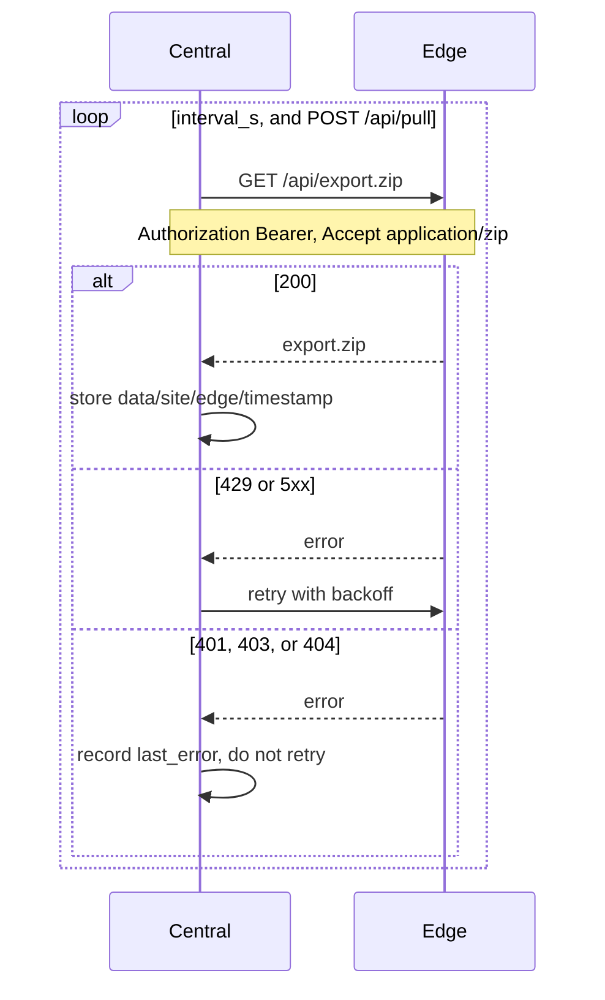
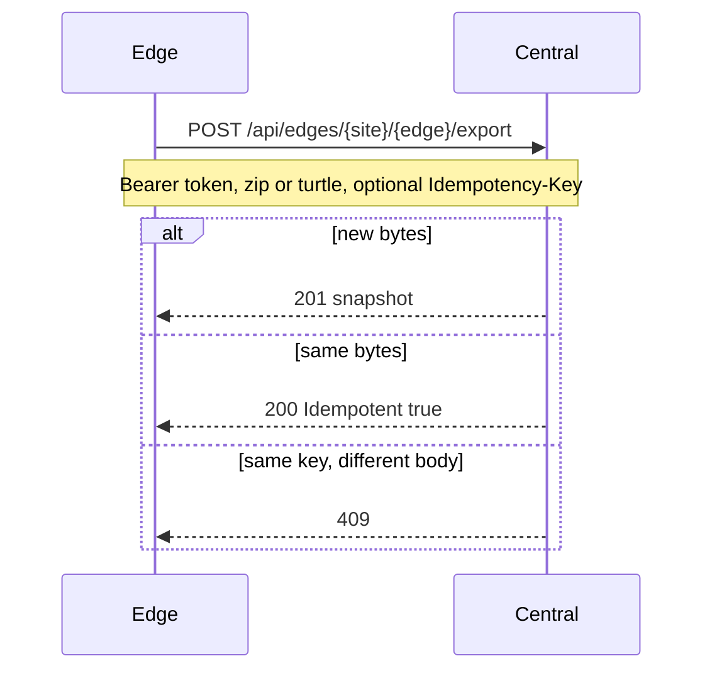
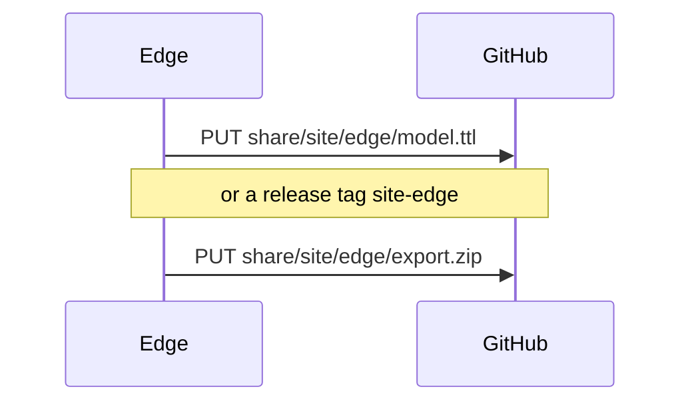

# Central collector

One process gathers 223P exports from many edges into one dataset. It talks only to those edges. It does not open a connection to a controller or a station, and it does not write to either.

ASHRAE 223P is the model. Haystack tags are an overlay. Units on the wire are QUDT local names (`DEG_C`, `PA`, `PERCENT`).

The listener defaults to TCP **8780**. That is not 80, 443, 1911, 4911, or the edge port 8080, so it can run on the same PC as a Niagara station. It binds the LAN interface named in the config, not every interface.

## Windows

From the repo root, in PowerShell:

```powershell
py -3.12 -m venv .venv
.\.venv\Scripts\Activate.ps1
python -m pip install -e ".[graph]"
python -m pip install -e .\central
Copy-Item central\config.example.yaml central\central.yaml
```

Edit `central\central.yaml`. Set `interface` to the adapter name from `Get-NetAdapter` (the example uses `Ethernet`). Set each edge `base_url`. Leave the token fields as environment variable names.

```powershell
$env:CENTRAL_TOKEN = "replace-me"
$env:EDGE_PI_BACNET_TOKEN = "replace-me"
$env:EDGE_PI_NIAGARA_TOKEN = "replace-me"
python -m central --config .\central\central.yaml
```

Open the firewall on a private profile for that port:

```powershell
New-NetFirewallRule -DisplayName "open-hvac central 8780" -Direction Inbound -Protocol TCP -LocalPort 8780 -Action Allow -Profile Private
```

`central\central.yaml` and `central\data\` are local. Do not commit them.

## Linux

```bash
python3 -m venv .venv
source .venv/bin/activate
python -m pip install -e ".[graph]"
python -m pip install -e ./central
cp central/config.example.yaml central/central.yaml
export CENTRAL_TOKEN=replace-me
export EDGE_PI_BACNET_TOKEN=replace-me
export EDGE_PI_NIAGARA_TOKEN=replace-me
python -m central --config central/central.yaml
```

`[graph]` installs the offline 223P SHACL stack (Shifty and OntoEnv). Without it the collector still stores, merges, and runs the reference check. Official SHACL is recorded as an error until that extra is installed and `shapes` plus `ontology_dir` are set. The vendored files are `bask_223p/ontologies/223p/223p.ttl` and `bask_223p/ontologies/223p/closure`.

## Docker Compose

Optional. From `central/`:

```bash
CENTRAL_TOKEN=replace-me docker compose up --build
```

The container publishes port 8780 and sets `CENTRAL_BIND_ANY=1` so the process can listen on all interfaces inside the network namespace. Do not set that variable on the Niagara PC. Pass edge tokens in the environment. They are not written into the image.

## Config

`config.example.yaml` lists edges. A token value in the file is rejected.

| Field | Meaning |
| --- | --- |
| `name`, `site` | Path segments. Storage is `data/<site>/<edge>/`. |
| `base_url` | Edge origin, no trailing path. HTTPS in production. |
| `edges[].token_env` | Name of the variable that holds that edge's bearer token. |
| `interface` | LAN adapter name (`Ethernet`) or one address. `0.0.0.0` is refused unless `CENTRAL_BIND_ANY=1`. |
| `port` | Default 8780. |
| `interval_s` | Seconds between pulls. Minimum 30. Default 3600. |
| `keep` | How many snapshots to retain per edge. |
| `pull_attempts`, `pull_backoff_s` | Retry count and base delay. |
| `max_upload_bytes` | Push limit. Default 32 MiB. |
| `sparql` | Default false. The route is absent until this is true. |
| `token_env` | Variable for the collector's own bearer token. Default `CENTRAL_TOKEN`. |

## Pull

The collector calls each edge:

- **Endpoint:** `GET {base_url}/api/export.zip`
- **Headers:** `Authorization: Bearer <token from token_env>`, `Accept: application/zip`, `User-Agent: open-hvac-central`
- **Schedule:** one pass at startup, then every `interval_s`. `POST /api/pull` runs every edge now. `POST /api/pull/{site}/{edge}` runs one.
- **Retry:** `pull_attempts` (default 3). Connection failures and HTTP 429, 500, 502, 503, and 504 wait `pull_backoff_s * 2^attempt` seconds. A numeric `Retry-After` replaces that delay and is capped at 30 seconds. 401, 403, and 404 are not retried. The log line is the edge name and the status. The token is not logged.
- **Store:** `data/<site>/<edge>/<utc timestamp>-<ns>/` with `model.ttl`, `export.zip`, and `manifest.json`. `latest.json` points at the newest. The same model SHA-256 does not create another directory. Older directories beyond `keep` are deleted.



## Push

An edge can upload instead of waiting for the schedule. The same bytes can also be published to GitHub, one path per edge.

### To the collector

- **Endpoint:** `POST /api/edges/{site}/{edge}/export`
- **Auth:** `Authorization: Bearer` using `CENTRAL_TOKEN`, or using that edge's token. The pair must already be listed in the config.
- **Payload:** `Content-Type: application/zip` containing one `model.ttl`, or `Content-Type: text/turtle`. `Content-Length` is required.
- **Size:** larger than `max_upload_bytes` is **413**.
- **Idempotency:** a body whose `model.ttl` SHA-256 matches the latest snapshot returns **200** with `Idempotent: true` and does not add a directory. An `Idempotency-Key` header that was already used for a different body returns **409**. The same key and the same bytes return the stored snapshot.



### To GitHub

`edge-microdot publish` is off until `EDGE_PUBLISH_ENABLED=1`. `EDGE_NAME` is required. `EDGE_SITE` defaults to the loaded site.

| Kind | Where the files go |
| --- | --- |
| `repo` | `share/<site>/<edge>/model.ttl` and `share/<site>/<edge>/export.zip` on `EDGE_PUBLISH_BRANCH` |
| `release` | Tag `<EDGE_PUBLISH_TAG>-<site>-<edge>` (default prefix `edge-share`). Assets on that tag are `model.ttl` and `export.zip`. |

A shared tag or a shared branch cannot land two edges on the same file. The token is `EDGE_PUBLISH_TOKEN` and is not logged.



## How the Turtle files are merged

Each stored `model.ttl` is parsed and loaded into its own named graph, `urn:central:graph:<site>:<edge>`. The dataset's default graph is the union of those named graphs, plus three provenance triples per edge (`rdf:type`, site, edge name).

`GET /api/model.ttl` is that default graph. `GET /api/model.trig` and `GET /api/model.nq` are the dataset, so a triple can be traced to the edge that sent it. `GET /api/model.jsonld` is one JSON-LD named graph per edge.

Pasting two Turtle files together and parsing the result keeps the triples, and it drops which file they came from. It also collides blank nodes. Both files may use `_:b0`. One parse makes that a single node, so a note from edge A and a note from edge B become one node with both labels. The collector does not do that. Before the union it replaces each blank node with a stable IRI `urn:central:bnode:<site>:<edge>:<n>`. The number comes from the node's neighborhood, not from the `_:b0` label, so the same file always skolemizes the same way and two edges do not share a blank node.

Entities that already use the same IRI become one node. `bacnet://<device>/<type>,<instance>` is that IRI. The external-reference node built from the same base and the same object identifier is stable as well. Two edges that both describe `bacnet://5007/analog-input,1` contribute one subject. Triples that are identical are stored once. That is why the union is smaller than the sum of the files.

Triples that share a subject and a predicate but not an object are both kept. RDF has no "latest value" rule here. `reconcile` is what surfaces the disagreement: edges that share at least one `bacnet://` key are paired, in config order. A matched object with the same name and the same QUDT local name is `duplicate-collapsed`. A matched object with a different name or unit is `conflicting`. An object seen on only one side is `only_in_left` or `only_in_right`. Nothing is deleted from the union to hide a conflict.

The reference check runs on the union every time. Official 223P SHACL runs when `shapes` is set to the vendored `223p.ttl` and `ontology_dir` is the vendored closure. A conflicting `bacnet:object-name` fails both checks. The report names the values. It does not choose one.

## Worked example

`examples/two-pi-bench/` is two exports of one AHU (device 5007). `edge1/model.ttl` is the BACnet edge. `edge2/model.ttl` is the Niagara edge, reading the same controller through a station. Names are generic. There are no tokens and no site names.

| | Triples |
| --- | --- |
| Edge 1 (BACnet) | 139 |
| Edge 2 (Niagara) | 138 |
| Sum | 277 |
| Union of the data | 177 |
| Collapsed because the IRI and the object already matched | 100 |
| Provenance triples added by the collector | 6 |
| `unified.ttl` | 183 |

The union is smaller than the sum because 100 triples are the same subject, predicate, and object on both edges: the shared device, the shared `bacnet://` nodes, and the points whose names and units agree (`SA-T`, `RA-T`). Those count once.

`unified.trig` has the named graphs. `reconcile.json` reports two `duplicate-collapsed` points (`SA-T`, `RA-T`), two `conflicting` points (`MA-T` is `DEG_C` on one edge and `DEG_F` on the other; `analog-input,4` is named `DAP-P` and `DuctStatic`), `SF-O` only on the BACnet edge, and `OA-T` only on the Niagara edge. Both conflicting values are still in `unified.ttl`. `validation.json` is the reference check plus official 223P SHACL. Both report the two object names and do not drop either.

Regenerate with:

```bash
python central/examples/two-pi-bench/regenerate.py
```

## HTTP API

Every route requires a bearer token. `GET /api/openapi.json` lists them. SPARQL is omitted from that document unless `sparql: true`. When it is on, `POST /api/sparql` accepts a read-only query and rejects updates.

| Method | Path | Body |
| --- | --- | --- |
| GET | `/api/edges` | Last-seen time, snapshot count, triple count, last error. No tokens. |
| GET | `/api/model.ttl` | Union. `Accept` on `/api/model` can ask for TriG, N-Quads, or JSON-LD. |
| GET | `/api/model.trig` | Named graphs and the union. |
| GET | `/api/model.jsonld` | One named graph per edge. |
| GET | `/api/edges/{site}/{edge}/model.ttl` | That edge's latest Turtle. |
| GET | `/api/reconcile` | Pairs that share a `bacnet://` ref. |
| GET | `/api/validation` | Reference check and SHACL. |
| POST | `/api/pull` | Pull every edge. |
| POST | `/api/pull/{site}/{edge}` | Pull one edge. |
| POST | `/api/edges/{site}/{edge}/export` | Push. See above. |
