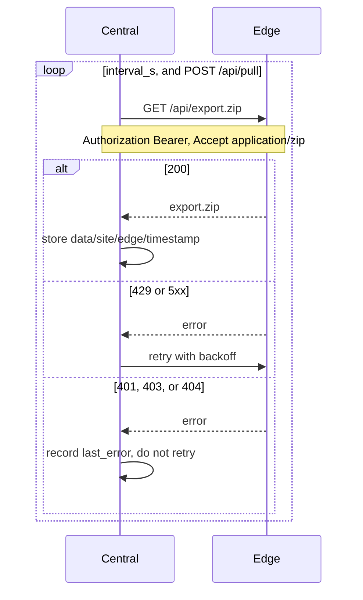
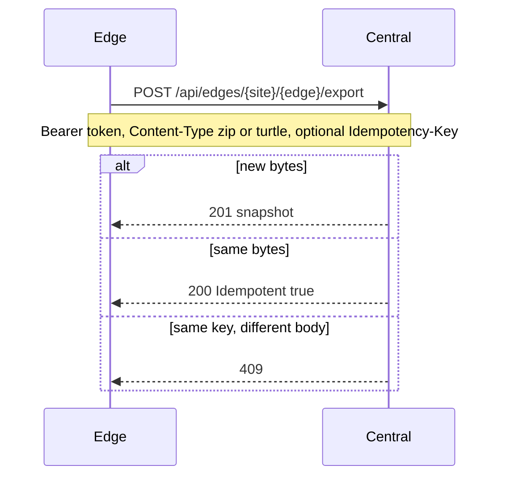

# Edge HTTP API

The edge service is the Microdot application under `examples/edge-microdot`. Every route below is registered on that process. A machine-readable copy is `GET /api/openapi.json` (bearer token required).

The service reads BACnet, Modbus TCP, and, when configured, a Niagara station. BACnet WriteProperty and release exist and stay off unless `EDGE_BACNET_WRITES_ENABLED=1` and the caller is an admin. Modbus has no write route. Site models, point lists, and history can describe a building and should be treated as sensitive.

Examples use `https://edge.example` and a user named `viewer`. Replace the host with the edge you run. Tokens are never accepted on the query string.

## Roles

`EDGE_ROLES` is a comma-separated list of `user:viewer`, `user:operator`, or `user:admin`. A user with no entry is a viewer.

| Role | Can |
| --- | --- |
| `viewer` | Read telemetry, the model, exports, and the OpenAPI document |
| `operator` | Viewer rights, plus `confirm_min` when rule writes are enabled |
| `admin` | Operator rights, plus BACnet WriteProperty and release when `EDGE_BACNET_WRITES_ENABLED=1` |

Dashboard HTML uses a session cookie from `POST /login`. Programmatic routes use `Authorization: Bearer`. Two token issuers exist:

- `POST /auth/token` (HTTP Basic) issues the bearer used by `/points`, `/latest`, `/api/export/bundle`, SPARQL, and the share routes.
- `POST /api/auth/login` issues the bearer used by the Open-FDD UI routes (`/api/equipment`, `/api/points`, `/api/samples`, `/api/results`, `/api/rules`). Share routes also accept this UI access token when its role is `viewer`, `operator`, or `admin`.

`GET /health`, `GET /api/meta`, `GET /login`, `GET /static/{path}`, and `GET /tls/allow` do not require a token. `GET /api/model.ttl` requires a token unless public model mode is on.

## Write flags

All of these default to off.

| Variable | Effect when unset | Effect when `1` |
| --- | --- | --- |
| `EDGE_RULES_WRITE` | `PUT /api/rules/{rule_id}/confirm_min` returns 403 `capability_disabled` | An operator or admin may set `confirm_min` |
| `EDGE_PUBLIC_MODEL` | `GET /api/model.ttl` requires a bearer token | That one route is public. No other route becomes public |
| `EDGE_PUBLISH_ENABLED` | Nothing is pushed off the box | A scheduled job and `edge-microdot publish` may upload `model.ttl` and `export.zip` |
| `EDGE_BACNET_WRITES_ENABLED` | `POST /api/bacnet/write` and `POST /api/bacnet/release` return 403 | An admin may write or release. Priorities 1 and 2 also need `EDGE_BACNET_ALLOW_PRIORITY_1_2=1` |

There is no flag that enables Modbus writes.

`EDGE_AUTH_DISABLED` is refused unless `EDGE_ALLOW_UNAUTHENTICATED=1`. Leave both unset on a real host.

## Rate limits

| Bucket | Default | Routes |
| --- | --- | --- |
| Login | 8 attempts per 60 seconds, per client address and username | `POST /login`, `POST /api/auth/login` |
| Export | `EDGE_EXPORT_RATE_LIMIT` (12) per `EDGE_EXPORT_RATE_WINDOW` seconds (60), per client address, shared by the whole bucket | `GET /api/model.ttl`, `GET /api/model`, `GET /api/points.csv`, `GET /api/config/export`, `GET /api/export.zip` |

A limited request returns **429** with `Retry-After`. Set `EDGE_EXPORT_RATE_LIMIT=0` to disable the export bucket. Other routes are not rate limited.

## Caching

Share responses send `ETag` (SHA-256 of the body) and `Last-Modified`. A matching `If-None-Match` returns **304** with an empty body. Bodies are streamed from a temporary file the same way `send_file` streams a file.

## Authentication and login

### GET /login

- **Auth / role:** none
- **Rate limit:** none
- **Response:** HTML form
- **Errors:** none

```bash
curl -sS https://edge.example/login
```

### POST /login

- **Auth / role:** none. Form fields `username` and `password`
- **Rate limit:** login bucket
- **Response:** **302** to `/` and a session cookie (`HttpOnly`, `Secure`, `SameSite=Strict`)
- **Errors:** **401** invalid credentials, **429** too many attempts

```bash
curl -sS -c cookies.txt -D - -o /dev/null \
  -d 'username=viewer&password=replace-me' \
  https://edge.example/login
```

### GET /logout

- **Auth / role:** dashboard session
- **Rate limit:** none
- **Response:** **302** to `/login`
- **Errors:** redirect to `/login` when the session is missing

```bash
curl -sS -b cookies.txt -D - -o /dev/null https://edge.example/logout
```

### POST /auth/token

- **Auth / role:** HTTP Basic. Any configured user
- **Rate limit:** none
- **Response:** `200` JSON `access_token`, `refresh_token`, `token_type` (`Bearer`), `expires_in`
- **Errors:** **401**

```bash
curl -sS -u viewer:replace-me https://edge.example/auth/token
```

```json
{"access_token": "...", "refresh_token": "...", "token_type": "Bearer", "expires_in": 3600}
```

### POST /auth/refresh

- **Auth / role:** none. JSON body `refresh_token`
- **Rate limit:** none
- **Response:** a new pair. The previous refresh token is spent
- **Errors:** **401** invalid or expired refresh token

```bash
curl -sS -H 'Content-Type: application/json' \
  -d '{"refresh_token":"..."}' \
  https://edge.example/auth/refresh
```

### GET /auth/ws-token

- **Auth / role:** dashboard session
- **Rate limit:** none
- **Response:** a short-lived access token (no refresh token)
- **Errors:** redirect to `/login` when the session is missing

```bash
curl -sS -b cookies.txt https://edge.example/auth/ws-token
```

### POST /api/auth/login

- **Auth / role:** none. JSON `{"username","password"}` only
- **Rate limit:** login bucket
- **Response:** access token, `user.role`, and an `ofdd_refresh` cookie (`Path=/api/auth`, `HttpOnly`, `Secure`, `SameSite=Strict`)
- **Errors:** **400** wrong body, **401** `invalid_credentials`, **404** when auth is disabled, **429** `rate_limited`

```bash
curl -sS -c cookies.txt -H 'Content-Type: application/json' \
  -d '{"username":"viewer","password":"replace-me"}' \
  https://edge.example/api/auth/login
```

### POST /api/auth/refresh

- **Auth / role:** `ofdd_refresh` cookie
- **Rate limit:** none
- **Response:** a new access token and a rotated cookie
- **Errors:** **401**, **404** when auth is disabled

```bash
curl -sS -b cookies.txt -c cookies.txt -X POST https://edge.example/api/auth/refresh
```

### POST /api/auth/logout

- **Auth / role:** cookie, when present, is revoked
- **Rate limit:** none
- **Response:** **204** and a cleared cookie
- **Errors:** **404** when auth is disabled

```bash
curl -sS -b cookies.txt -X POST https://edge.example/api/auth/logout
```

## Pages, health, and static files

### GET /

- **Auth / role:** dashboard session
- **Rate limit:** none
- **Response:** dashboard HTML
- **Errors:** redirect to `/login`

```bash
curl -sS -b cookies.txt https://edge.example/
```

### GET /sql

- **Auth / role:** dashboard session
- **Rate limit:** none
- **Response:** SQL page. Statements run on the edge DuckDB store through `POST /api/sql`
- **Errors:** redirect to `/login`

```bash
curl -sS -b cookies.txt https://edge.example/sql
```

### GET /static/{path}

- **Auth / role:** none
- **Params:** `path` must stay inside the static directory
- **Rate limit:** none
- **Response:** the file
- **Errors:** **404** for missing files, `..`, and links that leave the tree

```bash
curl -sS -o /dev/null -D - https://edge.example/static/login.html
```

### GET /tls/allow

- **Auth / role:** none. Used by the TLS proxy
- **Params:** query `domain`
- **Rate limit:** none
- **Response:** **200** empty when the name is listed in `EDGE_TLS_ALLOW` (or `EDGE_TLS_HOST`). **403** otherwise. `:443` allows no names

```bash
curl -sS -o /dev/null -w '%{http_code}\n' 'https://edge.example/tls/allow?domain=edge.example'
```

### GET /health

- **Auth / role:** none
- **Rate limit:** none
- **Response:** status, site id, source kind, counts. No sample values

```bash
curl -sS https://edge.example/health
```

```json
{"status": "ok", "site": "demo-site", "source": "bacnet", "point_count": 0, "auth_disabled": false}
```

## Telemetry

Bearer token from `POST /auth/token`. Role: viewer or higher. No rate limit.

### GET /points

- **Params:** optional `device`, `object_type`
- **Response:** `{"count", "points"}` for the targets the process is polling, including devices discovered at startup
- **Errors:** **401**

```bash
curl -sS -H "Authorization: Bearer $TOKEN" https://edge.example/points
```

### GET /latest

- **Response:** latest hot-cache sample per point
- **Errors:** **401**

```bash
curl -sS -H "Authorization: Bearer $TOKEN" https://edge.example/latest
```

### GET /history

- **Params:** optional `ref`, `start`, `end`, `limit` (capped at 5000)
- **Response:** samples from the in-memory store
- **Errors:** **401**

```bash
curl -sS -H "Authorization: Bearer $TOKEN" \
  'https://edge.example/history?ref=bacnet://10001/analog-input,1&limit=50'
```

### POST /poll/once

- **Response:** one poll, as `{"count", "samples"}`
- **Errors:** **401**

```bash
curl -sS -X POST -H "Authorization: Bearer $TOKEN" https://edge.example/poll/once
```

### GET /api/export/bundle

- **Params:** `hours` from just above 0 through 720 (default 24)
- **Response:** `application/zip` streamed as `edge-fdd-bundle.zip` (Parquet history, not the share zip)
- **Errors:** **400** bad `hours`, **401**

```bash
curl -sS -H "Authorization: Bearer $TOKEN" -o bundle.zip \
  'https://edge.example/api/export/bundle?hours=6'
```

## Model query

Bearer token. Role: viewer or higher. Requires `EDGE_ENABLE_SPARQL=1` and pyoxigraph, otherwise SPARQL answers **503**.

### POST /sparql

- **Body:** JSON `{"query": "SELECT ..."}`. Writes (`INSERT`, `DELETE`, `DROP`, `CLEAR`, `LOAD`, `CREATE`, `COPY`, `MOVE`, `ADD`) are rejected
- **Errors:** **400**, **401**, **503**

```bash
curl -sS -H "Authorization: Bearer $TOKEN" -H 'Content-Type: application/json' \
  -d '{"query":"SELECT * WHERE { ?s ?p ?o } LIMIT 5"}' \
  https://edge.example/sparql
```

### GET /sparql/example

- **Response:** an example query. When SPARQL is on, a preview is included
- **Errors:** **401**

```bash
curl -sS -H "Authorization: Bearer $TOKEN" https://edge.example/sparql/example
```

## WebSocket

### GET /live

Upgrades to a WebSocket of live samples.

- **Auth / role:** bearer access token, or the dashboard session cookie. A `token` query parameter is **401**
- **Rate limit:** none
- **Success:** **101** and a first JSON snapshot when the cache is non-empty
- **Errors:** **401** missing or invalid token, **403** when `Origin` is not this host

```bash
curl -sS -i -N \
  -H "Authorization: Bearer $TOKEN" \
  -H 'Connection: Upgrade' -H 'Upgrade: websocket' \
  -H 'Sec-WebSocket-Version: 13' -H 'Sec-WebSocket-Key: dGhlIHNhbXBsZSBub25jZQ==' \
  https://edge.example/live
```

## Open-FDD UI routes

`GET /api/meta` is public. The other UI routes expect the access token from `POST /api/auth/login`. Errors use `{"error": {"code", "message"}}`.

### GET /api/meta

- **Auth / role:** none
- **Response:** `contract_version`, app version, and `capabilities` (`rules_write`, `export_csv`, `export_parquet`, `sparql`, `auth`)

```bash
curl -sS https://edge.example/api/meta
```

### GET /api/equipment

- **Auth / role:** UI bearer, viewer or higher
- **Params:** `limit` (1–1000), `cursor`
- **Errors:** **400**, **401**

```bash
curl -sS -H "Authorization: Bearer $UI_TOKEN" https://edge.example/api/equipment
```

### GET /api/points

- **Auth / role:** UI bearer, viewer or higher
- **Params:** optional `equipment`, `limit`, `cursor`
- **Response:** one page of points with `input`, `unit`, and freshness. This is not `GET /api/points.csv`
- **Errors:** **400**, **401**

```bash
curl -sS -H "Authorization: Bearer $UI_TOKEN" 'https://edge.example/api/points?limit=100'
```

### GET /api/samples

- **Auth / role:** UI bearer, viewer or higher
- **Params:** required `point`, `from`, `to` (half-open). Optional `limit`, `cursor`
- **Errors:** **400**, **401**, **404** unknown point

```bash
curl -sS -H "Authorization: Bearer $UI_TOKEN" \
  'https://edge.example/api/samples?point=bacnet://10001/analog-input,1&from=2026-01-01T00:00:00Z&to=2026-01-02T00:00:00Z'
```

### GET /api/results

- **Auth / role:** UI bearer, viewer or higher
- **Params:** required `from`, `to`. Optional `equipment`, `rule`, `limit`, `cursor`
- **Errors:** **400**, **401**

```bash
curl -sS -H "Authorization: Bearer $UI_TOKEN" \
  'https://edge.example/api/results?from=2026-01-01T00:00:00Z&to=2026-01-02T00:00:00Z'
```

### GET /api/rules

- **Auth / role:** UI bearer, viewer or higher
- **Params:** `limit`, `cursor`
- **Errors:** **400**, **401**

```bash
curl -sS -H "Authorization: Bearer $UI_TOKEN" https://edge.example/api/rules
```

### PUT /api/rules/{rule_id}/confirm_min

- **Auth / role:** UI bearer, **operator or admin**
- **Write flag:** `EDGE_RULES_WRITE=1`. Off by default
- **Body:** `{"confirm_min": 15}` only. Integer 0 through 1440
- **Errors:** **400**, **401**, **403** `capability_disabled` or `forbidden`, **404**, **409** when the rule has no delay

```bash
curl -sS -X PUT -H "Authorization: Bearer $UI_TOKEN" \
  -H 'Content-Type: application/json' \
  -d '{"confirm_min":15}' \
  https://edge.example/api/rules/SV-STALE/confirm_min
```

### GET /rules

- **Auth / role:** bearer from `POST /auth/token`, viewer or higher
- **Response:** the local rule-engine snapshot (not the UI page)
- **Errors:** **401**

```bash
curl -sS -H "Authorization: Bearer $TOKEN" https://edge.example/rules
```

### GET /api/sql-rules

- **Auth / role:** bearer from `POST /auth/token`, viewer or higher
- **Response:** `engine` (`duckdb`) and the SQL rule file list
- **Errors:** **401**

```bash
curl -sS -H "Authorization: Bearer $TOKEN" https://edge.example/api/sql-rules
```

### POST /api/sql

- **Auth / role:** bearer from `POST /auth/token`, viewer or higher
- **Body:** `{"sql": "SELECT 1", "params": []}`
- **Response:** `columns`, `rows`, and `truncated`. One read-only statement. `SELECT`, `WITH`, `SHOW`, `DESCRIBE`, `EXPLAIN`, and `SUMMARIZE` are allowed. Writes and DDL are rejected.
- **Errors:** **400**, **401**

```bash
curl -sS -X POST -H "Authorization: Bearer $TOKEN" \
  -H 'Content-Type: application/json' \
  -d '{"sql":"SELECT COUNT(*) AS n FROM fdd.point","params":[]}' \
  https://edge.example/api/sql
```

## Points file

The BACnet Compose service does not pass `--points`. When that flag is omitted, the CLI loads `EDGE_POINTS_FILE`. The default is `/app/examples/edge-microdot/var/points.csv`, and Compose forwards the variable with that default. `./var` on the host is mounted at that directory.

`--points` wins over `EDGE_POINTS_FILE`. A missing fallback file is not a startup error. The process logs `no points are configured` and, with no rows loaded, the BACnet profile polls nothing.

### CSV format

Header and columns, in order:

```csv
device,object,property,units,label
10001,"analog-input,1",present-value,degC,Zone temperature
```

| Column | Required | Meaning |
| --- | --- | --- |
| `device` | yes | BACnet device instance |
| `object` | yes | `type,instance`, quoted because the value contains a comma |
| `property` | no | BACnet property. Empty means `present-value` |
| `units` | no | Unit string stored with the point |
| `label` | no | Display name |

Rows missing `device` or `object`, or whose `object` has no comma, are skipped. This file is the poll list. It is not the CSV returned by `GET /api/points.csv`.

## BACnet

Bearer token from `POST /auth/token`. Reads are paced by `EDGE_BACNET_MAX_INFLIGHT` (default 1) and `EDGE_BACNET_CHUNK_DELAY_S` (default `0.05`). Naming a device with `--devices` does not copy its object list into the poll set. Who-Is does not fill `GET /api/points.csv`.

### GET /api/bacnet/whois

- **Auth / role:** viewer or higher
- **Params:** `low` and `high` (required device-instance bounds), optional `timeout` and `address`
- **Response:** devices that answered I-Am. `object_name` is blank
- **Errors:** **400** `bad_request`, **401**, **502** `bacnet_error`, **503** `bacnet_inactive`

```bash
curl -sS -H "Authorization: Bearer $TOKEN" \
  'https://edge.example/api/bacnet/whois?low=5007&high=5007'
```

### GET /api/bacnet/devices

- **Auth / role:** viewer or higher
- **Response:** Who-Is for each named `--devices` instance, plus one `object-name` read
- **Errors:** **401**, **503** `bacnet_inactive`

```bash
curl -sS -H "Authorization: Bearer $TOKEN" https://edge.example/api/bacnet/devices
```

### GET /api/bacnet/devices/{instance}

- **Auth / role:** viewer or higher
- **Params:** `instance` path, optional `address`
- **Response:** device-object properties. This does not read the object list
- **Errors:** **401**, **404** `not_found`, **503** `bacnet_inactive`

```bash
curl -sS -H "Authorization: Bearer $TOKEN" \
  https://edge.example/api/bacnet/devices/5007
```

### GET /api/bacnet/devices/{instance}/objects

- **Auth / role:** viewer or higher
- **Params:** `instance` path, optional `address`
- **Response:** object-identifier, object-type, object-name, units, and description for that one device. Present-value is not read, and the catalog is not added to the poll set
- **Errors:** **401**, **502** `bacnet_error`, **503** `bacnet_inactive`

```bash
curl -sS -H "Authorization: Bearer $TOKEN" \
  https://edge.example/api/bacnet/devices/5007/objects
```

### GET /api/bacnet/priority

- **Auth / role:** viewer or higher
- **Params:** `device` and `object` (required), optional `address`
- **Response:** 16 priority slots and `relinquish-default`. Each slot is a number, a bool, or null. This route does not write
- **Errors:** **400** `bad_request`, **401**, **502** `bacnet_error`, **503** `bacnet_inactive`

```bash
curl -sS -H "Authorization: Bearer $TOKEN" \
  'https://edge.example/api/bacnet/priority?device=5007&object=analog-output,1'
```

### POST /api/bacnet/read

- **Auth / role:** viewer or higher
- **Body:** `device` and `reads` (`object` and `property` on each entry). A single `object` plus `property` is accepted as one read
- **Response:** property results for that device. `reads` longer than `EDGE_BACNET_READ_MAX` (default 50) is rejected
- **Errors:** **400** `bad_request`, **401**, **502** `bacnet_error`, **503** `bacnet_inactive`

```bash
curl -sS -H "Authorization: Bearer $TOKEN" -H 'Content-Type: application/json' \
  -d '{"device":5007,"reads":[{"object":"analog-input,1","property":"present-value"}]}' \
  https://edge.example/api/bacnet/read
```

### POST /api/bacnet/write

- **Auth / role:** admin, and `EDGE_BACNET_WRITES_ENABLED=1`
- **Body:** `device`, `object`, `value`. `property` defaults to `present-value`. `priority` defaults to 8 and must be 1..16. Priorities 1 and 2 also need `EDGE_BACNET_ALLOW_PRIORITY_1_2=1`
- **Response:** the write result. Accepted and denied attempts are appended to `EDGE_BACNET_AUDIT_LOG` (default `var/bacnet-audit.log`)
- **Errors:** **400** `bad_request`, **401**, **403** `forbidden`, **502** `bacnet_error`, **503** `bacnet_inactive`

```bash
curl -sS -H "Authorization: Bearer $TOKEN" -H 'Content-Type: application/json' \
  -d '{"device":5007,"object":"analog-output,1","value":21.5,"priority":8}' \
  https://edge.example/api/bacnet/write
```

### POST /api/bacnet/release

- **Auth / role:** admin, and `EDGE_BACNET_WRITES_ENABLED=1`
- **Body:** `device`, `object`, optional `property` and `priority`. This is a NULL write at that priority
- **Errors:** **400**, **401**, **403** `forbidden`, **502**, **503**

```bash
curl -sS -H "Authorization: Bearer $TOKEN" -H 'Content-Type: application/json' \
  -d '{"device":5007,"object":"analog-output,1","priority":8}' \
  https://edge.example/api/bacnet/release
```

## Modbus

Bearer token. The driver reads holding and input registers for configured points only. There is no coil or register write route and no flag that enables one. When the Modbus driver is not the active source, these routes return **503** `modbus_inactive`.

### GET /api/modbus/points

- **Auth / role:** viewer or higher
- **Response:** the configured points. No socket is opened
- **Errors:** **401**, **503** `modbus_inactive`

```bash
curl -sS -H "Authorization: Bearer $TOKEN" https://edge.example/api/modbus/points
```

### POST /api/modbus/read

- **Auth / role:** viewer or higher
- **Body:** optional `names` list. Omit it to read every configured point. A name that is not in the file returns `error:not_configured` and does not open a socket
- **Errors:** **400** `bad_request` when `names` is not a list, **401**, **503** `modbus_inactive`

```bash
curl -sS -H "Authorization: Bearer $TOKEN" -H 'Content-Type: application/json' \
  -d '{"names":["meter_energy"]}' \
  https://edge.example/api/modbus/read
```

## Model and data sharing

Share routes use the bearer from `POST /auth/token`, or a UI access token whose role is viewer, operator, or admin. They are read-only and share the export rate limit. Responses include `ETag` and `Last-Modified`.

Configured points are the points loaded from the points file at process start. Devices found later by Who-Is are not in the CSV, the config export, or the zip.

### GET /api/model.ttl

- **Auth / role:** viewer, unless `EDGE_PUBLIC_MODEL=1`
- **Response:** `text/turtle` of the 223P graph. When pyoxigraph is already loaded (`EDGE_ENABLE_SPARQL=1`), the bytes come from that store. Otherwise rdflib serializes the graph. An empty graph is still valid Turtle
- **Errors:** **401**, **429**, **304**

```bash
curl -sS -H "Authorization: Bearer $TOKEN" -D - -o model.ttl \
  https://edge.example/api/model.ttl
```

### GET /api/model

- **Auth / role:** viewer. Public model mode does **not** open this route
- **Params:** `Accept` of `text/turtle`, `application/ld+json`, or `application/n-triples`. Quality values are honored. Omitted `Accept` means Turtle
- **Response:** the same graph in the chosen format (`model.ttl`, `model.jsonld`, or `model.nt`)
- **Errors:** **401**, **406** `not_acceptable`, **429**, **304**

```bash
curl -sS -H "Authorization: Bearer $TOKEN" -H 'Accept: application/ld+json' \
  https://edge.example/api/model
```

```bash
curl -sS -H "Authorization: Bearer $TOKEN" -H 'Accept: application/n-triples' \
  https://edge.example/api/model
```

### GET /api/points.csv

- **Auth / role:** viewer
- **Response:** `text/csv` with header `site,label,role,units,source,device,object_id,property,ref,address`. `source` is `bacnet` or `modbus` when the point is one of those. `role` is the 223P-derived input term. Only configured points are listed
- **Errors:** **401**, **429**, **304**

```bash
curl -sS -H "Authorization: Bearer $TOKEN" -o points.csv \
  https://edge.example/api/points.csv
```

### GET /api/config/export

- **Auth / role:** viewer
- **Params:** `format=json` (default) or `format=yaml`. `Accept: application/yaml` or `application/json` is used when `format` is omitted
- **Response:** allowlisted settings and the configured points. Keys that are not on the allowlist are omitted. Passwords, tokens, keys, user hashes, station URLs, and anything stored only in a point's extra fields are not copied. This is not a byte copy of the file on disk
- **Errors:** **401**, **406**, **429**, **304**

```bash
curl -sS -H "Authorization: Bearer $TOKEN" https://edge.example/api/config/export
```

```bash
curl -sS -H "Authorization: Bearer $TOKEN" \
  'https://edge.example/api/config/export?format=yaml'
```

### GET /api/export.zip

- **Auth / role:** viewer
- **Response:** `application/zip` streamed as `export.zip` with `model.ttl`, `points.csv`, `config.json`, and `manifest.json`
- **Manifest:** `generated_at` (UTC, `Z`), `edge_version`, `role_file` (`roles/openfdd-roles.json`, `present`, and `sha256` when that file is on the box), and `files` (`sha256` and `bytes` of the other three members)
- **Errors:** **401**, **429**, **304**

The role file is the Open-FDD vocabulary when it has been vendored. The manifest hash is null until the file is present. It is not fetched at runtime.

```bash
curl -sS -H "Authorization: Bearer $TOKEN" -o export.zip \
  https://edge.example/api/export.zip
```

```json
{
  "edge_version": "0.1.0",
  "generated_at": "2026-01-01T00:00:00Z",
  "role_file": {"name": "roles/openfdd-roles.json", "present": false, "sha256": null},
  "files": {"model.ttl": {"sha256": "...", "bytes": 120}}
}
```

### GET /api/openapi.json

- **Auth / role:** viewer. Not part of the export rate limit
- **Response:** OpenAPI 3.1 JSON for every route on this process
- **Errors:** **401**, **304**

```bash
curl -sS -H "Authorization: Bearer $TOKEN" https://edge.example/api/openapi.json
```

## Publishing

Publishing is off by default. Turn it on only if you intend other people to browse the model and the zip. Those files can contain point names, equipment relationships, and addresses.

| Variable | Default | Meaning |
| --- | --- | --- |
| `EDGE_PUBLISH_ENABLED` | off | `1` arms the CLI and the scheduled job |
| `EDGE_PUBLISH_TOKEN` | unset | GitHub token. Read from the environment only. Never written to the zip, the logs, or a command argument |
| `EDGE_PUBLISH_REPO` | unset | `owner/name` |
| `EDGE_PUBLISH_KIND` | `release` | `release` or `repo` |
| `EDGE_PUBLISH_TAG` | `edge-share` | Release tag prefix. The tag that is written is `<tag>-<site>-<edge>` |
| `EDGE_PUBLISH_BRANCH` | `edge-share` | Branch when kind is `repo`. The branch must already exist. Paths differ per edge |
| `EDGE_PUBLISH_INTERVAL` | `86400` | Seconds between scheduled pushes. Minimum 60 |
| `EDGE_SITE` | loaded site | Path segment. With `EDGE_NAME`, keeps this edge off another edge's files |
| `EDGE_NAME` | unset | Required. Path segment for this edge |

The token needs permission to create a release, or to write `share/<site>/<edge>/model.ttl` and `share/<site>/<edge>/export.zip` on the branch. A release uses the tag `edge-share-<site>-<edge>` (or `<EDGE_PUBLISH_TAG>-<site>-<edge>`). Asset names on that tag stay `model.ttl` and `export.zip`. Two edges do not share a tag or a path, so one push cannot replace the other. The release note states that site data may be sensitive.

The running service pushes once shortly after startup and then every interval. It logs the repository and ref, not the token. A failed push is retried on the next interval and does not stop polling.

One-shot, with the same variables:

```bash
EDGE_PUBLISH_ENABLED=1 \
EDGE_PUBLISH_TOKEN=... \
EDGE_PUBLISH_REPO=example/edge-share \
EDGE_SITE=bench \
EDGE_NAME=pi-bacnet \
edge-microdot publish --points path/to/points.yaml
```

Exit **2** when publishing is off. Exit **1** when the token, repository, edge name, or GitHub call fails. The command prints the reason and does not print the token.

Push to the collector, instead of GitHub, is `POST /api/edges/{site}/{edge}/export` on the central process. The payload, limit, and idempotency rule are in the next section and in `central/README.md`.

## Central collector

`central/` is a separate process. It stores 223P exports from many edges. It does not open a connection to a controller or a station.

The listener defaults to TCP **8780**, which is not 80, 443, 1911, 4911, or the edge's 8080. It binds the LAN interface named in the config, not every interface. Every route requires `Authorization: Bearer`. The central token is `CENTRAL_TOKEN`. A push may also use that edge's own token. Tokens are read from the environment. They are not written to the config, the data directory, or the log.

`GET /api/openapi.json` is the machine-readable list. SPARQL is not in that document unless `sparql: true`.

### Pull

The collector calls each configured edge:

- **Endpoint:** `GET {base_url}/api/export.zip`
- **Header:** `Authorization: Bearer <edge token>` and `Accept: application/zip`
- **Schedule:** once at startup, then every `interval_s` (default 3600, minimum 30). `POST /api/pull` runs the same pass immediately. `POST /api/pull/{site}/{edge}` pulls one edge.
- **Retry:** 3 attempts (`pull_attempts`). Connection errors and HTTP 429, 500, 502, 503, and 504 wait `pull_backoff_s * 2^attempt` seconds, or `Retry-After` when it is a number of seconds (capped at 30). 401, 403, and 404 are not retried.
- **Store:** `data/<site>/<edge>/<timestamp>-<ns>/model.ttl` and `export.zip`. The last `keep` snapshots are kept. The same model bytes do not create another snapshot.



### Push

An edge may upload to the collector instead of waiting for a pull.

- **Endpoint:** `POST /api/edges/{site}/{edge}/export`
- **Auth:** `Authorization: Bearer` with `CENTRAL_TOKEN` or with that edge's token. The site and edge must already be in the config.
- **Payload:** `Content-Type: application/zip` (an `export.zip` that contains `model.ttl`) or `Content-Type: text/turtle`. `Content-Length` is required.
- **Size:** `max_upload_bytes` (default 32 MiB). A larger body is **413**.
- **Idempotency:** the same model bytes as the latest snapshot return **200** and `Idempotent: true` and do not add a directory. `Idempotency-Key` reused with a different body is **409**. The same key and the same bytes return the stored snapshot.
- **GitHub alternative:** `edge-microdot publish` writes `share/<site>/<edge>/model.ttl` and `share/<site>/<edge>/export.zip` on a branch, or a release tag `<tag>-<site>-<edge>`. See Publishing above.



After a pull or a push the collector loads each edge as a named graph, unions them, runs reconcile on edges that share a `bacnet://` ref, and runs 223P validation. Turtle (`GET /api/model.ttl`) is the union. TriG (`GET /api/model.trig`) and N-Quads (`GET /api/model.nq`) keep the named graphs. JSON-LD is `GET /api/model.jsonld`. How the merge treats blank nodes and conflicting values is in `central/README.md`.
