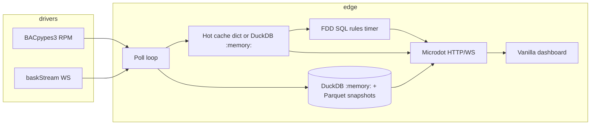

# edge-microdot

A **1 GB RAM–class** ingest service for BACnet and Niagara stations. It mirrors the `examples/live-ingest` data model (`bacnet://` and `niagara://` refs, DuckDB history, optional 223P SPARQL) but replaces FastAPI with **[Microdot](https://github.com/miguelgrinberg/microdot)** so a Raspberry Pi 4 can run polling, caching, batched history, and a small dashboard without pulling in Starlette/Uvicorn stacks.

## Why Microdot on the edge?

| Concern | FastAPI (`live-ingest`) | Microdot (`edge-microdot`) |
| --- | --- | --- |
| HTTP stack | Starlette + Uvicorn | Microdot built-in server |
| Typical use | Laptop / VM demos, notebooks | Pi 4, aarch64, SD card |
| Graph extras | OntoEnv, pyshacl, playground UI | Optional pyoxigraph only |
| Hot path | Same RPM / baskStream logic | Same chunking & auth fallbacks |

FastAPI remains the right default for rich SPARQL playgrounds and validation tooling. On the edge, most value is **poll → cache → batched DuckDB → rules → WebSocket**, which Microdot serves with a smaller import surface.

## Architecture



## Quickstart — Worker Pi 1 (BACnet)

Host networking exposes UDP **47808**.

```bash
git clone <repo> && cd <repo>/examples/edge-microdot
cp .env.example .env
# Set EDGE_BACNET_ADDRESS to this host's LAN CIDR, e.g. 192.168.1.50/24
docker compose --profile bacnet build
docker compose --profile bacnet up -d
```

The BACnet service uses **host networking** and binds BACpypes3 to
`EDGE_BACNET_ADDRESS` (passed as `--address`). A wildcard such as `0.0.0.0`
will not work. Device instances default to `54545,5007` and are discovered
with Who-Is plus each device's object-list.

Native (on the Pi):

```bash
python3 -m pip install -e ../.. -e '.[sparql]'
export EDGE_DRIVER=bacnet
export EDGE_BACNET_ADDRESS=192.168.1.50/24
python -m edge_microdot \
  --address 192.168.1.50/24 \
  --devices 54545,5007 \
  --max-props 25
```

Open `http://<pi>:8080/` for live values, sparklines, and rule flags.

## Quickstart — Worker Pi 2 (Niagara read-only)

Credentials **only** from the environment:

```bash
cp .env.example .env
# Fill NIAGARA_URL / NIAGARA_USER / NIAGARA_PASS in .env (chmod 600)
docker compose --profile niagara up -d
```

With no `--points` file the Niagara driver browses the station (default
`BASK_BASE_ORD=slot:/Drivers`) and then polls those objects read-only.

The client uses form SCRAM first, then **HTTP Basic** on `/stream/health` and the WebSocket when SCRAM final messages are empty (same behavior as `bask_223p.bacnet.baskstream`).

## Configuration reference

| Variable | Default | Meaning |
| --- | --- | --- |
| `EDGE_DRIVER` | `fake` | `bacnet`, `niagara`, or `fake` |
| `EDGE_SITE` | `demo-site` | Site id on samples |
| `EDGE_HOST` / `EDGE_PORT` | `0.0.0.0` / `8080` | HTTP bind |
| `EDGE_POLL_INTERVAL` | `15` | Seconds between polls |
| `EDGE_FLUSH_INTERVAL` | `30` | Sync hot cache to in-memory DuckDB |
| `EDGE_SNAPSHOT_INTERVAL` | `300` | Compact ZSTD Parquet snapshot period (seconds) |
| `EDGE_MEMORY_RETENTION_HOURS` | `48` | Rolling window kept in `:memory:` DuckDB |
| `EDGE_FDD_INTERVAL` | `60` | Rule evaluation period |
| `EDGE_DB_PATH` | `var/edge_history.duckdb` | Snapshot base path (writes `var/snapshots/*.parquet`, no growing `.duckdb` file) |
| `EDGE_DB_MAX_MB` | `100` | Oldest-first retention cap |
| `EDGE_HOT_BACKEND` | `dict` | `dict` or `duckdb` (`:memory:`) |
| `EDGE_ENABLE_SPARQL` | `0` | Load pyoxigraph store. An explicit `0` stays off even if a TTL is loaded |
| `EDGE_DUCKDB_WASM_URL` | jsDelivr `@duckdb/duckdb-wasm@1.29.0/+esm` | ESM module URL for `/sql` (set to self-host) |
| `EDGE_DUCKDB_WASM_BUNDLE_BASE` | — | Optional self-hosted base URL for `.wasm` / `.worker.js` |
| `EDGE_BACNET_ADDRESS` | — | BACpypes3 bind address (`host/prefix`, required for the BACnet driver) |
| `EDGE_BACNET_DEVICES` | `54545,5007` | Device instances to discover via Who-Is when no point file is given |
| `NIAGARA_URL` / `USER` / `PASS` | — | Required for Niagara driver |
| `NIAGARA_INSECURE` | `0` | Skip TLS verify (lab only) |
| `NIAGARA_WS_AUTH_HEADER` | `0` | Basic auth on WS handshake |

### Authentication

Microdot built-ins only (no Caddy, no extra HTTP stack):

| Mechanism | Use |
| --- | --- |
| `TokenAuth` | API routes (`Authorization: Bearer …`) |
| `BasicAuth` | `POST /auth/token` only |
| `Session` + `Login` | Dashboard at `/` (cookie, `EDGE_SESSION_TTL`) |

Environment:

| Variable | Default | Meaning |
| --- | --- | --- |
| `EDGE_SECRET_KEY` | random at startup if unset | HMAC secret for JWT + session |
| `EDGE_USERS` | — | `user:pbkdf2_sha256$iter$salt$hash` (semicolon-separated) |
| `EDGE_TOKEN_TTL` | `3600` | Access token `exp` (seconds) |
| `EDGE_SESSION_TTL` | `EDGE_TOKEN_TTL` | Session cookie lifetime |
| `EDGE_AUTH_DISABLED` | off | Test/demo only |

Hash a password for `EDGE_USERS`:

```bash
python3 -c "from edge_microdot.security import hash_password; print('operator:'+hash_password('change-me'))"
```

Endpoints:

- `POST /auth/token` — BasicAuth → `{access_token, refresh_token, expires_in}`
- `POST /auth/refresh` — JSON `{refresh_token}` → new pair; `401` if invalid/expired
- `GET /login`, `POST /login`, `GET /logout` — dashboard session
- `GET /auth/ws-token` — session cookie → bearer token for WebSocket
- `WS /live?token=` — requires valid access token

Optional native HTTPS on the Pi: set `EDGE_SSL_CERT` and `EDGE_SSL_KEY`, then pass an `ssl.SSLContext` (see `cli._load_ssl_context()`). Terminate TLS on the device only when you control certificate rotation on the SD card.

### HTTP routes

- `GET /health` — public status
- `GET /points`, `/latest`, `/history`, `/rules`, `/api/sql-rules`, `POST /sparql`, `POST /poll/once` — bearer token
- `GET /api/export/bundle?hours=N` — bearer token; returns a ZIP of `input_sample.parquet`, `point.parquet`, and `rule_result.parquet` (Open-FDD core schemas, SI units)
- `GET /sql` — session login; browser DuckDB-WASM SQL runner (zero query compute on the Pi)
- `WS /live` — bearer token (query or `Authorization`)

## Portable Parquet bundle & browser DuckDB-WASM (`/sql`)

The edge service keeps DuckDB **in memory** (`duckdb.connect(':memory:')`) fed from the hot cache and periodic writes a compact, ZSTD-compressed Parquet snapshot under `var/snapshots/` (`EDGE_SNAPSHOT_INTERVAL=300`, rotated under `EDGE_DB_MAX_MB=100`). On startup it reloads the newest valid snapshot back into memory.

`GET /api/export/bundle?hours=N` (bearer token required) exports a ZIP of three Parquet files whose schemas match the Open-FDD core contract (SI values, UTC timestamps). `fdd.point.role` is the 223P-derived snake_case input term (no `sat`/`mat` acronyms).

| File | Columns | Notes |
| --- | --- | --- |
| `input_sample.parquet` | `site_id`, `point_key`, `ts`, `value` | `fdd.input_sample`; `value` is SI |
| `point.parquet` | `site_id`, `point_key`, `equipment_id`, `role`, `role_source`, `kind`, `unit`, `source_unit`, `si_scale`, `si_offset`, `haystack_id`, `attrs`, `updated_at` | `fdd.point`; `role` = 223P snake_case input term |
| `rule_result.parquet` | Open-FDD `fdd.rule_result` columns (`status`, `fault_hours`, `covered_hours`, `subject_key`, windows, …) | Latest assessment per series/rule |

Open `/sql` (behind session login) to run ad-hoc SQL or any cookbook rule from `sql/fdd/rules/*.sql` directly in your browser via **DuckDB-WASM** (loaded from jsDelivr by default; override `EDGE_DUCKDB_WASM_URL` and `EDGE_DUCKDB_WASM_BUNDLE_BASE` to self-host). The browser fetches `/api/export/bundle?hours=N` with your token, registers the three Parquet files as `fdd.input_sample`, `fdd.point`, and `fdd.rule_result` plus a `sensor_history` view, and executes queries locally with zero compute on the host.

DuckDB stays in-process with the edge app. An optional later fdd-worker container sharing the Parquet snapshot volume is described in `docs/duckdb-wasm-bundle.md`. Schema parity with the Open-FDD NF app is tabulated in `docs/parity-with-open-fdd-nf.md`.

**Notebook (optional):** `notebooks/edge_duckdb_sweep.ipynb` is optional — `/sql` runs the same `sql/fdd/rules/*.sql` files in the browser. If you still prefer a local notebook, download `/api/export/bundle` or inspect a Parquet snapshot from `var/snapshots/` with `duckdb -ui` on a PC.

## Memory notes (SPARQL)

On a Pi 4 with **1 GB RAM**, run with `EDGE_ENABLE_SPARQL=0` unless you need joins in the field. A illustrative 223P TTL (~few thousand triples) with pyoxigraph 0.5.x adds on the order of **30–80 MB RSS** on top of the ingest core; keep SPARQL off when headroom is tight. Measurement script: `pytest tests/test_memory.py -s` inside the container image (see CI-like numbers in the PR).

## Tests

```bash
docker build -f Dockerfile -t edge-microdot:test ../..
docker run --rm edge-microdot:test python -m pytest tests -s
```

## SD-card friendliness

- History writes are **batched** (`EDGE_FLUSH_INTERVAL`).
- Logs go to **stdout** and a small **rotating file** under `/tmp` by default.
- History runs in `:memory:` DuckDB and writes **infrequent atomic ZSTD Parquet snapshots** (`EDGE_SNAPSHOT_INTERVAL`), rotating oldest snapshots to stay under `EDGE_DB_MAX_MB`.