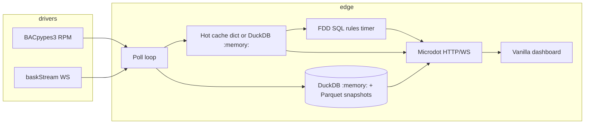

# edge-microdot

A **1 GB RAM–class** ingest service for BACnet and Niagara stations. It mirrors the `examples/live-ingest` data model (`bacnet://` and `niagara://` refs, DuckDB history, optional 223P SPARQL) but replaces FastAPI with **[Microdot](https://github.com/miguelgrinberg/microdot)** so a Raspberry Pi 4 can run polling, caching, batched history, and a small dashboard without pulling in Starlette/Uvicorn stacks.

## Why Microdot on the edge?

| Concern | FastAPI (`live-ingest`) | Microdot (`edge-microdot`) |
| --- | --- | --- |
| HTTP stack | Starlette + Uvicorn | Microdot built-in server |
| Typical use | Laptop / VM demos, notebooks | Pi 4, aarch64, SD card |
| Graph extras | OntoEnv, pyshacl, playground UI | Optional pyoxigraph only |
| Hot path | Same RPM / baskStream logic | Same chunking & auth fallbacks |

FastAPI remains the right default for rich SPARQL playgrounds and validation tooling. On the edge, most value is **poll → cache → batched DuckDB → rules → WebSocket**, which Microdot serves with a smaller import surface.

## Architecture



## Quickstart — Worker Pi 1 (BACnet)

Host networking exposes UDP **47808**.

```bash
git clone <repo> && cd <repo>/examples/edge-microdot
cp .env.example .env
# Set EDGE_BACNET_ADDRESS to this host's LAN CIDR, e.g. 192.168.1.50/24
docker compose --profile bacnet build
docker compose --profile bacnet up -d
```

The BACnet service uses **host networking** and binds BACpypes3 to
`EDGE_BACNET_ADDRESS` (passed as `--address`). A wildcard such as `0.0.0.0`
will not work. Route-aware mode keeps addresses such as
`2000:7@192.168.204.200`. `--devices` names controllers for Who-Is. It does
**not** poll every object on those controllers. Present-value polling runs
only for points listed in `--points`. See [docs/bacnet.md](docs/bacnet.md).

Compose does not pass `--points`. The process loads `EDGE_POINTS_FILE`
(default `/app/examples/edge-microdot/var/points.csv`, the mounted `./var`
directory) when that file exists. Without it the BACnet profile polls nothing
and logs `no points are configured`. Put a CSV there before starting:

```csv
device,object,property,units,label
10001,"analog-input,1",present-value,degC,Zone temperature
```

`object` is `type,instance` and is quoted because it contains a comma. `property` defaults to `present-value` when the cell is empty.

Native (on the Pi):

```bash
python3 -m pip install -e ../.. -e '.[sparql]'
export EDGE_DRIVER=bacnet
export EDGE_BACNET_ADDRESS=192.168.1.50/24
python -m edge_microdot \
  --address 192.168.1.50/24 \
  --devices 54545,5007 \
  --points configs/points.csv \
  --max-props 25
```

Read-only catalog of device instances 5007 and 54545 (Who-Is, device info,
object-name / units / description — not present-value):

```bash
python -m edge_microdot --driver bacnet \
  --address "$EDGE_BACNET_ADDRESS" \
  --scan --devices 5007,54545
```

Open `https://<pi-ip>/` for live values, sparklines, and rule flags. Caddy issues a `tls internal` certificate, so browsers warn until its root CA is trusted. Microdot itself listens on loopback only; plain `http://<pi>:8080` is no longer reachable from the LAN.

## Quickstart — Worker Pi 2 (Niagara read-only)

Credentials **only** from the environment:

```bash
cp .env.example .env
# Fill NIAGARA_URL / NIAGARA_USER / NIAGARA_PASS in .env (chmod 600)
docker compose --profile niagara up -d
```

With no `--points` file the Niagara driver browses the station (default
`BASK_BASE_ORD=slot:/Drivers`) and then polls those objects read-only.

The client uses form SCRAM first, then **HTTP Basic** on `/stream/health` and the WebSocket when SCRAM final messages are empty (same behavior as `bask_223p.bacnet.baskstream`).

## Configuration reference

| Variable | Default | Meaning |
| --- | --- | --- |
| `EDGE_DRIVER` | `fake` | `bacnet`, `niagara`, `modbus`, or `fake` |
| `EDGE_SITE` | `demo-site` | Site id on samples |
| `EDGE_HOST` / `EDGE_PORT` | `127.0.0.1` / `8080` | HTTP bind (Caddy is the public listener) |
| `EDGE_POLL_INTERVAL` | `15` | Seconds between polls |
| `EDGE_FLUSH_INTERVAL` | `30` | Sync hot cache into in-memory DuckDB (not a card write) |
| `EDGE_SD_CARD` | off (`1` in Compose) | Use `EDGE_DURABLE_MINUTES` for Parquet snapshots and the log file |
| `EDGE_DURABLE_MINUTES` | `15` when SD card, else `5` | Minutes between Parquet snapshots and log-file drains |
| `EDGE_SNAPSHOT_INTERVAL` | durable minutes, in seconds | Overrides the snapshot cadence |
| `EDGE_MEMORY_RETENTION_HOURS` | `48` | Rolling window kept in `:memory:` DuckDB |
| `EDGE_RAM_ROWS` | `250000` | Maximum sample rows kept in memory |
| `EDGE_DUCKDB_MEMORY_MB` | `256` | DuckDB `memory_limit`, inside the 512m container cap |
| `EDGE_LOG_FLUSH_MINUTES` | same as durable minutes | File-log drain interval. Stdout stays immediate |
| `EDGE_LOG_LEVEL` | `INFO` (`WARNING` in Compose) | Compose defaults to WARNING so Docker's json log stays quiet |
| `EDGE_FDD_INTERVAL` | `60` | Rule evaluation period |
| `EDGE_DB_PATH` | `var/edge_history.duckdb` | Snapshot base path (writes `var/snapshots/*.parquet`, no growing `.duckdb` file) |
| `EDGE_DB_MAX_MB` | `100` | Oldest-first retention cap |
| `EDGE_HOT_BACKEND` | `dict` | `dict` or `duckdb` (`:memory:`) |
| `EDGE_ENABLE_SPARQL` | `0` | Load pyoxigraph store. An explicit `0` stays off even if a TTL is loaded |
| `EDGE_DUCKDB_WASM_URL` | `/static/vendor/duckdb/duckdb-browser.mjs` | Vendored DuckDB-WASM 1.32.0 (no CDN) |
| `EDGE_DUCKDB_WASM_BUNDLE_BASE` | `/static/vendor/duckdb` | Base for `duckdb-eh.wasm` and the worker |
| `EDGE_BACNET_ADDRESS` | — | BACpypes3 bind address (`host/prefix`, required for the BACnet driver) |
| `EDGE_BACNET_DEVICES` | `54545,5007` | Named device instances for Who-Is. Not an object-list poll |
| `EDGE_POINTS_FILE` | `/app/examples/edge-microdot/var/points.csv` | Points file used when `--points` is omitted. CSV columns: `device,object,property,units,label` |
| `EDGE_BACNET_MAX_INFLIGHT` | `1` | In-flight BACnet requests per device |
| `EDGE_BACNET_CHUNK_DELAY_S` | `0.05` | Gap between requests to one device. Raise on MS/TP |
| `EDGE_BACNET_WHOIS_TIMEOUT` | `5` | Seconds to wait for I-Am |
| `EDGE_BACNET_READ_MAX` | `50` | Maximum entries in one `POST /api/bacnet/read` |
| `EDGE_BACNET_ROUTE_AWARE` | `1` | Keep `net:mac@router` addresses |
| `EDGE_BACNET_WRITES_ENABLED` | off | Allow WriteProperty. Also requires an `admin` role |
| `EDGE_BACNET_ALLOW_PRIORITY_1_2` | off | Permit priority 1 and 2 |
| `EDGE_BACNET_AUDIT_LOG` | `var/bacnet-audit.log` | JSONL of every write and release |
| `EDGE_BACNET_BBMD` | — | Optional foreign-device BBMD address |
| `NIAGARA_URL` / `USER` / `PASS` | — | Required for Niagara driver |
| `NIAGARA_INSECURE` | `0` | Skip TLS verify (lab only) |
| `NIAGARA_CA_FILE` | — | CA bundle for a station certificate |
| `EDGE_TLS_HOST` | `:443` | Caddy site address |
| `EDGE_TLS_ALLOW` | `EDGE_TLS_HOST` | Names Caddy may certificate. `:443` allows none |
| `EDGE_TLS_BIND` | every interface | Address Caddy binds |
| `NIAGARA_WS_AUTH_HEADER` | `0` | Basic auth on WS handshake |

### Authentication

Microdot built-ins, with Caddy in front for LAN TLS (`Caddyfile`, `tls internal`). The dashboard WebSocket is `wss://` on HTTPS and authenticates with the session cookie or an `Authorization: Bearer` header. Tokens are not accepted on the query string.

`/api/*` implements Open-FDD UI contract 1.0.0 (`contract/open-fdd-ui-api.yaml`). `confirm_min` is the only tuner and stays at each rule's shipped default; writes stay off unless `EDGE_RULES_WRITE=1`. `EDGE_ROLES` is `user:viewer`, `user:operator`, or `user:admin`. BACnet writes need `admin`. Startup logs which rules apply and which are skipped because a required 223P role is missing. `OPENFDD_VERSION` is `5.0.22`. `scripts/fetch_openfdd.py` vendors the release zips after a sha256 check and does nothing until that tag exists.

| Mechanism | Use |
| --- | --- |
| `TokenAuth` | API routes (`Authorization: Bearer …`) |
| `BasicAuth` | `POST /auth/token` only |
| `Session` + `Login` | Dashboard at `/` (cookie, `EDGE_SESSION_TTL`) |

Environment:

| Variable | Default | Meaning |
| --- | --- | --- |
| `EDGE_SECRET_KEY` | required, 32 bytes | HMAC root secret. Session and token keys are derived from it. `EDGE_SECRET_KEY_FILE` overrides it |
| `EDGE_USERS` | — | `user:pbkdf2_sha256$iter$salt$hash` (semicolon-separated). `EDGE_USERS_FILE` overrides it |
| `EDGE_TOKEN_TTL` | `3600` | Access token `exp` (seconds) |
| `EDGE_SESSION_TTL` | `EDGE_TOKEN_TTL` | Session cookie lifetime |
| `EDGE_AUTH_DISABLED` | off | Test/demo only. Refused unless `EDGE_ALLOW_UNAUTHENTICATED=1` |
| `EDGE_ROLES` | viewer | `user:viewer`, `user:operator`, or `user:admin` |

Hash a password for `EDGE_USERS`:

```bash
python3 -c "from edge_microdot.security import hash_password; print('operator:'+hash_password('change-me'))"
```

Endpoints:

- `POST /auth/token` — BasicAuth → `{access_token, refresh_token, expires_in}`
- `POST /auth/refresh` — JSON `{refresh_token}` → new pair; `401` if invalid/expired
- `GET /login`, `POST /login`, `GET /logout` — dashboard session
- `GET /auth/ws-token` — session cookie → bearer token for WebSocket
- `WS /live?token=` — requires valid access token

Optional native HTTPS on the Pi: set `EDGE_SSL_CERT` and `EDGE_SSL_KEY`, then pass an `ssl.SSLContext` (see `cli._load_ssl_context()`). Terminate TLS on the device only when you control certificate rotation on the SD card.

### HTTP routes

- `GET /health` — public status
- `GET /points`, `/latest`, `/history`, `/rules`, `/api/sql-rules`, `POST /sparql`, `POST /poll/once` — bearer token
- `GET /api/export/bundle?hours=N` — bearer token; returns a ZIP of `input_sample.parquet`, `point.parquet`, and `rule_result.parquet` (Open-FDD core schemas, SI units)
- `/api/bacnet/*` — bearer token. Who-Is, one-device object catalog, ReadProperty / ReadPropertyMultiple, and priority-array reads. Never map or poll every point on a live system: legacy MS/TP and IoT networks bottleneck easily. `POST /api/bacnet/read` rejects a `reads` list longer than `EDGE_BACNET_READ_MAX` (default 50), and the read routes share the per-device pace (`EDGE_BACNET_MAX_INFLIGHT`, `EDGE_BACNET_CHUNK_DELAY_S`). Writes and releases stay off unless `EDGE_BACNET_WRITES_ENABLED=1` and the token's user is `admin`. Details in [docs/bacnet.md](docs/bacnet.md).
- `/api/modbus/points` and `POST /api/modbus/read` — bearer token, configured registers only. Optional `pymodbus` extra. Details in [docs/modbus.md](docs/modbus.md).
- `GET /sql` — session login; browser DuckDB-WASM SQL runner (zero query compute on the Pi)
- `WS /live` — bearer token (query or `Authorization`)

## Portable Parquet bundle & browser DuckDB-WASM (`/sql`)

The edge service keeps DuckDB **in memory** (`duckdb.connect(':memory:')`) fed from the hot cache and periodic writes a compact, ZSTD-compressed Parquet snapshot under `var/snapshots/` (`EDGE_SNAPSHOT_INTERVAL=300`, rotated under `EDGE_DB_MAX_MB=100`). On startup it reloads the newest valid snapshot back into memory.

`GET /api/export/bundle?hours=N` (bearer token required) exports a ZIP of three Parquet files whose schemas match the Open-FDD core contract (SI values, UTC timestamps). `fdd.point.role` is the 223P-derived snake_case input term (no `sat`/`mat` acronyms).

| File | Columns | Notes |
| --- | --- | --- |
| `input_sample.parquet` | `site_id`, `point_key`, `ts`, `value` | `fdd.input_sample`; `value` is SI |
| `point.parquet` | `site_id`, `point_key`, `equipment_id`, `role`, `role_source`, `kind`, `unit`, `source_unit`, `si_scale`, `si_offset`, `haystack_id`, `attrs`, `updated_at` | `fdd.point`; `role` = 223P snake_case input term |
| `rule_result.parquet` | Open-FDD `fdd.rule_result` columns (`status`, `fault_hours`, `covered_hours`, `subject_key`, windows, …) | Latest assessment per series/rule |

Open `/sql` (behind session login) to run ad-hoc SQL or any cookbook rule from `sql/fdd/rules/*.sql` directly in your browser via **DuckDB-WASM** (loaded from jsDelivr by default; override `EDGE_DUCKDB_WASM_URL` and `EDGE_DUCKDB_WASM_BUNDLE_BASE` to self-host). The browser fetches `/api/export/bundle?hours=N` with your token, registers the three Parquet files as `fdd.input_sample`, `fdd.point`, and `fdd.rule_result` plus a `sensor_history` view, and executes queries locally with zero compute on the host.

DuckDB stays in-process with the edge app. An optional later fdd-worker container sharing the Parquet snapshot volume is described in `docs/duckdb-wasm-bundle.md`. Schema parity with the Open-FDD NF app is tabulated in `docs/parity-with-open-fdd-nf.md`.

**Notebook (optional):** `notebooks/edge_duckdb_sweep.ipynb` is optional — `/sql` runs the same `sql/fdd/rules/*.sql` files in the browser. If you still prefer a local notebook, download `/api/export/bundle` or inspect a Parquet snapshot from `var/snapshots/` with `duckdb -ui` on a PC.

## Memory notes (SPARQL)

On a Pi 4 with **1 GB RAM**, run with `EDGE_ENABLE_SPARQL=0` unless you need joins in the field. A illustrative 223P TTL (~few thousand triples) with pyoxigraph 0.5.x adds on the order of **30–80 MB RSS** on top of the ingest core; keep SPARQL off when headroom is tight. Measurement script: `pytest tests/test_memory.py -s` inside the container image (see CI-like numbers in the PR).

## Tests

```bash
docker build -f Dockerfile -t edge-microdot:test ../..
docker run --rm edge-microdot:test python -m pytest tests -s
```

## SD-card friendliness

History stays in `:memory:` DuckDB. The card sees an atomic ZSTD Parquet snapshot, not a write per sample.

Compose turns `EDGE_SD_CARD=1` on for both Pi services. `EDGE_DURABLE_MINUTES` (default **15**) is how often a snapshot is written and how often the log file is drained. The in-memory sync (`EDGE_FLUSH_INTERVAL`, default 30 seconds) does not touch the card. Oldest snapshots rotate under `EDGE_DB_MAX_MB`.

`/tmp` is a 32 MB tmpfs and Docker's json log is capped at 512 KB, with `EDGE_LOG_LEVEL=WARNING`. Shutdown still writes one snapshot and drains the log buffer. Set `EDGE_SNAPSHOT_INTERVAL` in seconds when you want a different cadence than the durable minutes.

**`var/` ownership.** The image runs as uid 1000 (`edge`), not root. Compose runs a one-shot `var-init` service before either edge service; it `chown`s `./var` to 1000:1000, so a `var/` created by an older root-run image or by Docker itself is fixed automatically on `docker compose up`. Without Compose, run `sudo chown -R 1000:1000 var` once. Caddy gets only `EDGE_TLS_HOST` and `EDGE_TLS_BIND`, not the whole `.env`.
