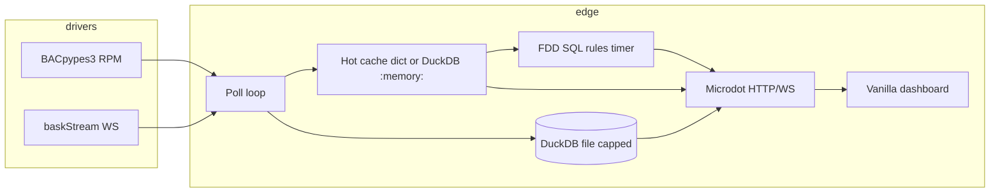

# edge-microdot

A **1 GB RAM–class** ingest service for BACnet and Niagara stations. It mirrors the `examples/live-ingest` data model (`bacnet://` and `niagara://` refs, DuckDB history, optional 223P SPARQL) but replaces FastAPI with **[Microdot](https://github.com/miguelgrinberg/microdot)** so a Raspberry Pi 4 can run polling, caching, batched history, and a small dashboard without pulling in Starlette/Uvicorn stacks.

## Why Microdot on the edge?

| Concern | FastAPI (`live-ingest`) | Microdot (`edge-microdot`) |
| --- | --- | --- |
| HTTP stack | Starlette + Uvicorn | Microdot built-in server |
| Typical use | Laptop / VM demos, notebooks | Pi 4, aarch64, SD card |
| Graph extras | OntoEnv, pyshacl, playground UI | Optional pyoxigraph only |
| Hot path | Same RPM / baskStream logic | Same chunking & auth fallbacks |

FastAPI remains the right default for rich SPARQL playgrounds and validation tooling. On the edge, most value is **poll → cache → batched DuckDB → rules → WebSocket**, which Microdot serves with a smaller import surface.

## Architecture



## Quickstart — Worker Pi 1 (BACnet)

Host networking exposes UDP **47808**.

```bash
git clone <repo> && cd <repo>/examples/edge-microdot
cp .env.example .env
# Set EDGE_BACNET_ADDRESS to this host's LAN CIDR, e.g. 192.168.204.59/24
docker compose --profile bacnet build
docker compose --profile bacnet up -d
```

The BACnet service uses **host networking** and binds BACpypes3 to
`EDGE_BACNET_ADDRESS` (passed as `--address`). A wildcard such as `0.0.0.0`
will not work. Device instances default to `54545,5007` and are discovered
with Who-Is plus each device's object-list.

Native (on the Pi):

```bash
python3 -m pip install -e ../.. -e '.[sparql]'
export EDGE_DRIVER=bacnet
export EDGE_BACNET_ADDRESS=192.168.204.59/24
python -m edge_microdot \
  --address 192.168.204.59/24 \
  --devices 54545,5007 \
  --max-props 25
```

Open `http://<pi>:8080/` for live values, sparklines, and rule flags.

## Quickstart — Worker Pi 2 (Niagara read-only)

Credentials **only** from the environment:

```bash
cp .env.example .env
# Fill NIAGARA_URL / NIAGARA_USER / NIAGARA_PASS in .env (chmod 600)
docker compose --profile niagara up -d
```

With no `--points` file the Niagara driver browses the station (default
`BASK_BASE_ORD=slot:/Drivers`) and then polls those objects read-only.

The client uses form SCRAM first, then **HTTP Basic** on `/stream/health` and the WebSocket when SCRAM final messages are empty (same behavior as `bask_223p.bacnet.baskstream`).

## Configuration reference

| Variable | Default | Meaning |
| --- | --- | --- |
| `EDGE_DRIVER` | `fake` | `bacnet`, `niagara`, or `fake` |
| `EDGE_SITE` | `demo-site` | Site id on samples |
| `EDGE_HOST` / `EDGE_PORT` | `0.0.0.0` / `8080` | HTTP bind |
| `EDGE_POLL_INTERVAL` | `15` | Seconds between polls |
| `EDGE_FLUSH_INTERVAL` | `30` | Batch flush to DuckDB file |
| `EDGE_FDD_INTERVAL` | `60` | Rule evaluation period |
| `EDGE_DB_PATH` | `var/edge_history.duckdb` | History file |
| `EDGE_DB_MAX_MB` | `100` | Oldest-first retention cap |
| `EDGE_HOT_BACKEND` | `dict` | `dict` or `duckdb` (`:memory:`) |
| `EDGE_ENABLE_SPARQL` | `0` | Load pyoxigraph store. An explicit `0` stays off even if a TTL is loaded |
| `EDGE_BACNET_ADDRESS` | — | BACpypes3 bind address (`host/prefix`, required for the BACnet driver) |
| `EDGE_BACNET_DEVICES` | `54545,5007` | Device instances to discover via Who-Is when no point file is given |
| `NIAGARA_URL` / `USER` / `PASS` | — | Required for Niagara driver |
| `NIAGARA_INSECURE` | `0` | Skip TLS verify (lab only) |
| `NIAGARA_WS_AUTH_HEADER` | `0` | Basic auth on WS handshake |

### HTTP routes

- `GET /health` — source, counts, SPARQL flag, DB size
- `GET /points` — configured targets
- `GET /latest` — hot cache
- `GET /history?ref=&start=&end=` — DuckDB window
- `GET /rules` — last FDD evaluation
- `POST /sparql` — read-only SELECT (optional)
- `WS /live` — JSON sample stream

## Memory notes (SPARQL)

On a Pi 4 with **1 GB RAM**, run with `EDGE_ENABLE_SPARQL=0` unless you need joins in the field. A illustrative 223P TTL (~few thousand triples) with pyoxigraph 0.5.x adds on the order of **30–80 MB RSS** on top of the ingest core; keep SPARQL off when headroom is tight. Measurement script: `pytest tests/test_memory.py -s` inside the container image (see CI-like numbers in the PR).

## Tests

```bash
docker build -f Dockerfile -t edge-microdot:test ../..
docker run --rm edge-microdot:test python -m pytest tests -s
```

## SD-card friendliness

- History writes are **batched** (`EDGE_FLUSH_INTERVAL`).
- Logs go to **stdout** and a small **rotating file** under `/tmp` by default.
- DuckDB retention trims **oldest rows** when `EDGE_DB_MAX_MB` is exceeded (no aggressive `fsync` per sample).